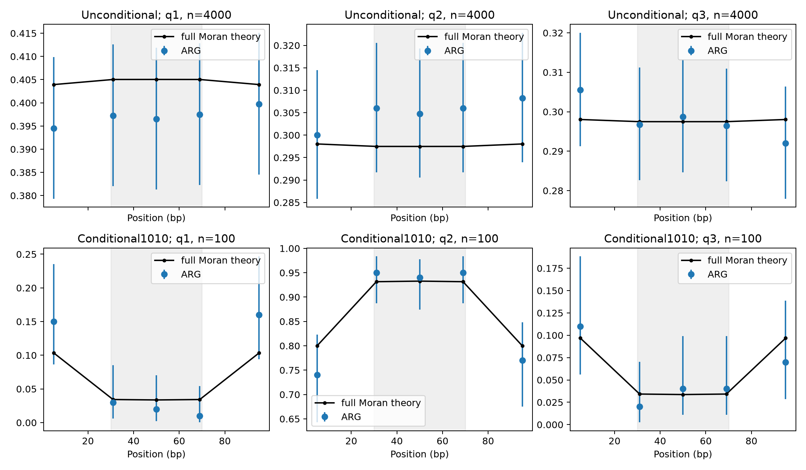
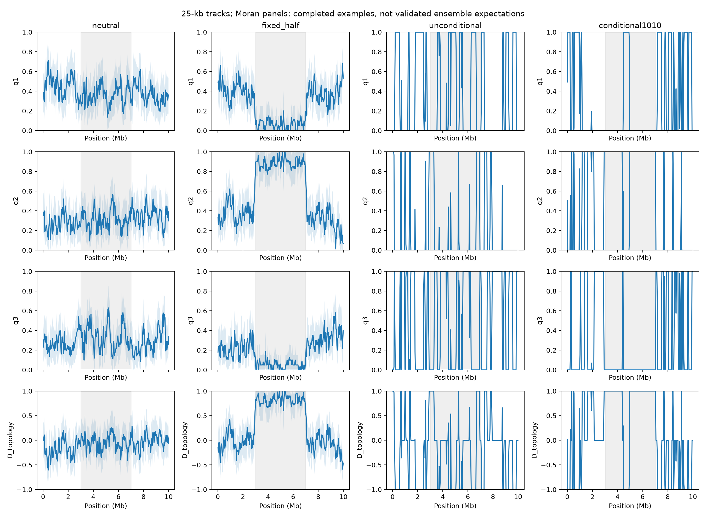
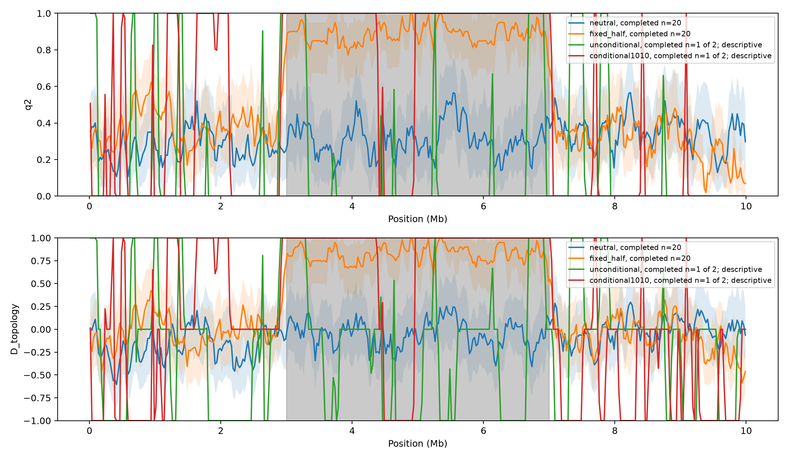
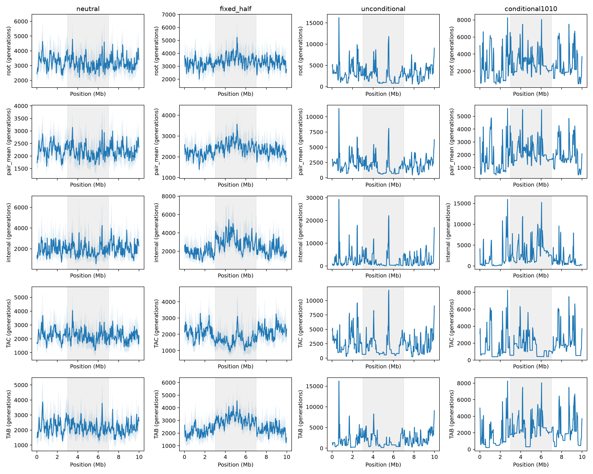
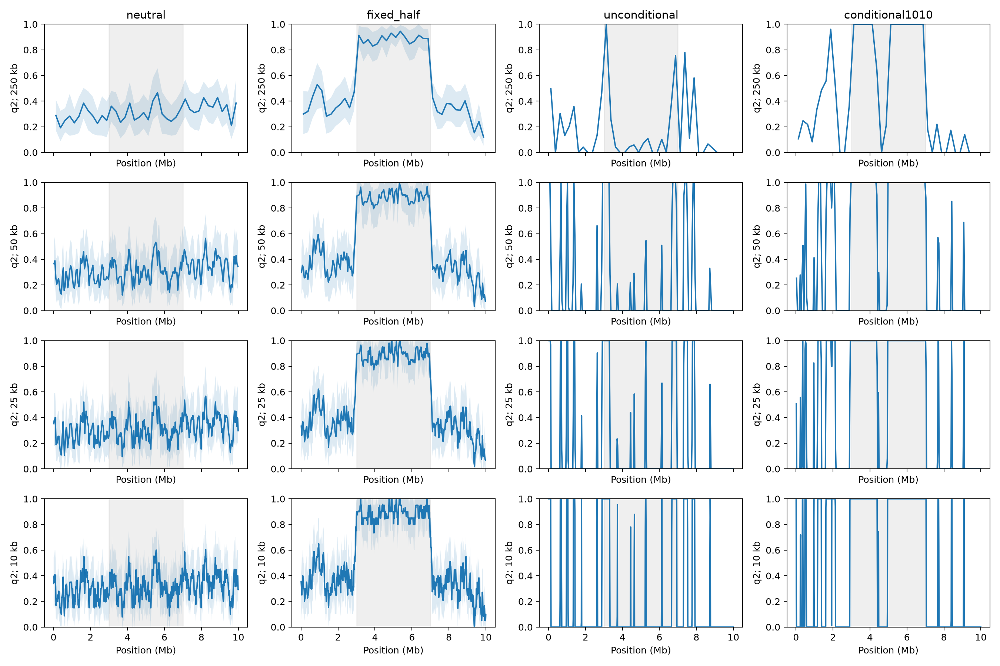
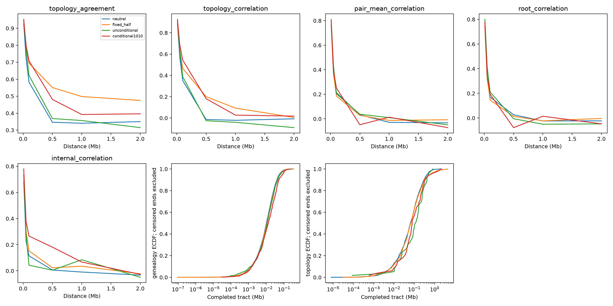
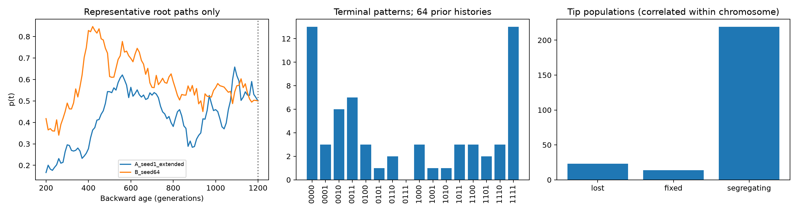
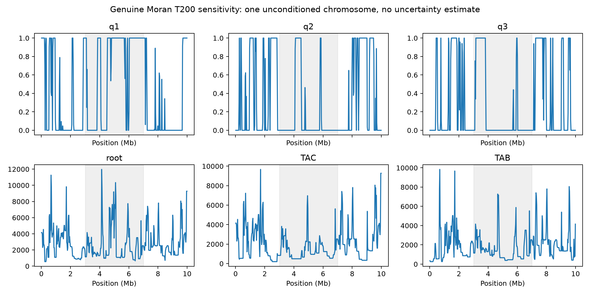

# Stochastic Moran MSRC-ARG chromosome validation

## Final measured pilot outcome

The 100-chromosome replication target was **not reached**. Of the two original
unconditional subjects and two correctly conditioned subjects, one per
condition completed under the extended limit; all failed attempts remain.

| Primary subject | Outcome | Seconds | Peak MiB | Marginal intervals |
|---|---|---:|---:|---:|
|Unconditional seed 0, replay|time-limited|600.03|354.59|unavailable|
|Unconditional seed1, replay|complete|446.21|356.30|515|
|Conditional1010 seed 30|time-limited|600.02|454.98|unavailable|
|Conditional1010 seed 64|complete|521.92|421.87|438|

Initial unconditional seeds 0/1 also hit 180 seconds; these are earlier attempts,
not additional subjects. Seed0 stopped near generation 1161.85 with 40 carriers;
seed 30 stopped near 1074.23 with 50. Background origin is 1200, so neither prefix
reached ordinary older ancestry. No finished marginal tree or completion-time
projection is inferred from them. The separate T200 example completed in 244.73
seconds at 245.40MiB, with different declared demography.

The completed conditional chromosome has 407 distinct dated genealogies and
three quartet topologies. Its q2 span fraction is .8655 inside versus .1907
outside; genealogy changes are 36.25/Mb inside versus 48.67/Mb outside, and
quartet changes 1/Mb versus 7.67/Mb. Its internal branches average 3403 versus 1472
generations. TAC/TBD inside average 1538/842, versus TAB/TAD 2458/2782.
Even restricting to intervals with topology q2, internal length averages 3666
inside versus 988 outside. These are descriptive within-chromosome contrasts,
not validated expectation estimates or independent observations.

The unconditional completed chromosome sampled 0000; seed 0 sampled 1111. These
labels were drawn from their histories and retained. The fixed audit has 13/64
0000 and 13/64 1111 patterns, and 10/64 histories with at least one absorbing
terminal population. The causal frequency of signal loss from fixation is not
estimable from the incomplete genealogy cohort. Conditioning markedly changes
which histories/tip patterns are sampled; its population-level effect remains
underpowered here.

## Scope and scientific distinction

This experiment uses the production continuous-time, finite-copy-count Moran
process followed by the production MSRC-ARG. It does not replace frequencies
with prescribed p=.5 or a Wright–Fisher approximation. The unchanged fixed-half
positive control and neutral ARG chromosomes are reused as references only.
The target is 100 independent chromosomes per main condition, subject to measured
feasibility. The bounded pilot results below do not establish that precision.

## Model and shared-history audit

M=2Ne=2000 gene copies, Ne=1000, root initial law delta(K=1000), root age 200
and 1000 generations of structured root ancestry give origin age 1200. Terminal
and sister branches each last 100 generations. L=10Mb, marker 5 Mb, suppressed
interval [3,7)Mb, r=1e-8 per bp/generation, cross-retention kappa=.01, selection0.
The root initial law is specified, not assumed stationary.

The Moran clock has attempted replacement rate M/2 per generation. With
p=K/M and selected reproductive probability p_sel=p(1+s)/(1+s*p), the
state-changing rates are q_plus=(M/2)*p_sel*(1-p) and
q_minus=(M/2)*(1-p_sel)*p. At neutrality the variance rate is p(1-p)/M.
The simulator samples only state-changing replacements with exponential
waiting times at q_plus+q_minus. K=0 and M are absorbing without mutation.
Selection is native genic fitness 1+s for background 1, fitness 1 for background 0.
The main experiment has s=0; a nonzero clock is tested independently.

A parent population is simulated once from older to younger time. Each daughter
starts with a Binomial(M_daughter, parental terminal frequency) count, then
has its own forward Moran evolution. Daughters are conditionally independent
given the same parent endpoint, not marginally independent histories. Terminal
states are Bernoulli samples at each terminal frequency. One complete realized
history object, with consistent species ancestry, is supplied to all genomic
positions of a chromosome. Independent seed numbers generate independent
histories. The shared FrequencyHistory container happens to reside in
wright_fisher.py; it does not turn these histories into a Wright–Fisher process.

At the declared origin, background structure ceases backward in time. Older
ancestry has ordinary same-population pair coalescence 1/(2Ne), with no background
switching. Younger coalescence is background dependent and constrained by the
species population. Background switching backward in time and physical genomic
recombination retain the existing ARG coupling and are not separate invented
clocks. No ARG rate, event generator, history rule or SMC′ code is modified.

## Correct unconditional and conditional sampling

The fixed 64-prior-draw audit uses SeedSequence([20261123,i,0]) for i=0,...,63.
Histories and terminal background samples are drawn without survival filtering.
Loss, fixation and weak signals remain in the sample. Experiment A uses the
first two prespecified seeds 0/1, not seeds chosen for a visible signal.

Experiment B selects only terminal pattern 1010, before genealogy simulation.
The fixed audit selected seed 30. A separately documented rejection extension
then stops at the next 1010 or 64 additional trials; seed 64 was immediately
accepted. Both selected histories are exact prior draws conditioned on sampled
terminal states; no terminal state is overwritten. Genealogy failure does not
trigger another accepted history or replacement. ARG randomness uses the
independent SeedSequence([20261123,i,1]) stream. Replaying a seed with a larger
budget produces the same chromosome and is not another independent replicate.

The fixed audit measured 1/64=1.5625% acceptance with exact 95% interval
[0.0396%,8.4010%]. Its forward histories required 262.91 seconds in total.
The extension is not pooled into that fixed-n probability estimate. Among 256
correlated terminal populations, 23 were at loss and 14 at fixation; these are
not 256 independent chromosomes. Terminal-pattern frequencies and representative
paths are archived. One root trajectory is not used to represent every replicate.

## Independent small-M validation

The smaller control uses M=20, Ne=10, root age2, structured root10, nonzero
terminal/sister branches1, initial K=10, chromosome100bp, r=.001, marker50,
region[30,70), kappa=.01. Full balanced stochastic multispecies theory is
computed independently before genealogies, including binomial inheritance.
There are 4000 independently seeded prior histories/chromosomes, no simulation
failures and 100 naturally accepted1010 configurations. Their frequency .025
matches the theoretical pattern probability .0253302.

Across five positions, maximum absolute unconditional q error is .01022.
All 15 unconditional q criteria have exact 95% difference intervals inside the
previous practical tolerance ±.05. For conditional 1010, maximum error is .05979;
3/15 criteria meet that equivalence criterion and 12 remain unresolved by
precision. None demonstrates a difference beyond ±.05. The conditional sample
is not reported as fully validated just because its intervals are broad.

The new automated checks cover arbitrary interval/window intersections and
resolution conservation, the native selected/absorbing clock, and deterministic
shared-history replay/origin. Existing Moran tests also cover finite-count CTMC
fluctuations, absorbing laws, terminal sampling and inheritance. Statistical
results remain separate from deterministic tests.

## What these pilots answer

A genuine conditional Moran chromosome can exhibit the localized alternative
pattern and branch-time contrasts: the completed example demonstrates this
possibility. The fixed-p signal is therefore not solely an artifact of holding
p constant. The experiment does **not** establish its typical magnitude or
persistence across stochastic histories. The incomplete unconditional and
conditional cohorts cannot estimate their population-level difference.

The completed unconditional example has q2=.174 inside and .154 outside, with
initial sampled pattern 0000. It has 515 intervals, 485 distinct dated genealogies
and all three topologies. The conditional example has 438 intervals and 407
distinct dated genealogies. Increasing to 1000 windows resolves interval mixtures
and boundaries more closely; it does not yield 1000 independent genealogies.
At 25 kb/10kb some finer variation is genuine within-chromosome structure, but
statistical precision remains limited by one completed primary chromosome per
condition. Runtime censoring also prevents unbiased complete-case inference.

The 64-history audit records 10 histories with at least one absorbing terminal
population and 26 with all-equal sampled states. It quantifies those occurrences,
not the proportion whose genealogy signal was eliminated. That causal question
requires completed unbiased genealogy cohorts. Matched small-M theory provides
stronger statistical evidence in its own domain; it does not validate large-M
marginals or branch-time expectations.

## Spatial resolution, estimands and uncertainty

Each completed native chromosome is summarized at 250 kb/50kb/25kb/10kb:
40/200/400/1000 windows. Tree-window intersections determine weights; no
midpoint assignment or independent tree generation is used. All resolutions
refer to exactly the same continuous ARG. Windows, marginal tree intervals,
distinct dated genealogies and distinct quartet topologies are reported
separately. Coordinates are zero-based, half-open bp; tree times are generations.

q1=AB|CD, q2=AC|BD, q3=AD|BC. D_topology=q2-q1 is not Patterson's D. A window
value for one chromosome is its span fraction with each quartet. A cohort curve
averages across chromosomes. Bootstrap resampling selects whole chromosomes,
with the same resampling indices across all positions in a track. At n=1 no
interval is drawn; at n=2 bootstrap ranges cannot provide adequate precision.
Neither adjacent windows nor tree intervals are replication units.

Branch tracks include root age, mean pairwise MRCA time, unrooted quartet
internal-edge length, TAC/TBD/TAB/TAD, and pair averages grouped by *sampled
terminal* background. Those groups may later switch backgrounds; the label
does not assert that backgrounds remain constant along ancestry. A group with
no eligible pairs is missing, not zero. No matching analytical branch-time
reward calculation is available here; all time contrasts are simulation based.

Spatial tables include topology agreement, pair/root/internal-time correlation,
genealogy and topology changes/Mb, separately inside/outside. Dated genealogy
identity is the full six-pair MRCA signature, not just topology or node IDs.
High-resolution windows locate changes more closely but do not add independent
chromosomes, create genealogies or cure poor replication. No empirical data
calibration or mutation-rate conclusion is made.

## Figures

Empty panels explicitly mean no completed chromosome, not zero quartet
probabilities. Neutral/fixed-half reference n=20 does not substitute for genuine
Moran replication. Simulation curves at M=2000 have no exact theory overlay:
the stochastic target is computationally unavailable.

## Resource constraints and next steps

Initial 1000-generation-root unconditional pilots each hit 180 seconds. The
same seed 0 is replayed at 600 seconds; conditional seeds 30/64 are also bounded
at 600 seconds. All attempts and partial generation/carrier diagnostics remain
in the archive. A separate 200-generation-root sensitivity completed at 244.73
seconds; it is not pooled into or presented as the primary1000-generation model.
Its 25-kb tracks are a single genuine Moran chromosome, without uncertainty:

The 30-second instrumented primary prefix generated 582,738 history records;
its ARG reached roughly generation 69 with 26 active carriers at the limit.
Dense frequency boundaries cause repeated recombination/pair-rate and boundary
option reconstruction. This is a different workload from the unchanged
fixed-frequency positive control, which has no hundreds of thousands of count
changes. Partial instrumented timings are not extrapolated completion times.
All processes are bounded at 1.5GiB RSS and some ran concurrently; wall times
are resource diagnostics rather than controlled comparative benchmarks.

The large-M exact calculation was separately profiled under a 30-second budget.
The stable binomial PMF from the previous task remains in use. Here the
profile is dominated by expm_multiply and sparse count-process propagation;
full multispecies recursion does not complete. No constant-p, single-population
or diffusion approximation supplies its missing target. Small-M matched theory
validation and large-M computational feasibility are different claims.

The sensitivity grid beyond the bounded T200 trial, alternative root laws and
large-M selected experiments is deferred under the measured runtime limits.
Selection rates are unit-tested, but no selected 10-Mb result is claimed.
The 100-chromosome target is a goal, not a completed dataset. Exact final attempt
counts, runtime/RSS and finished outputs are in analysis_summary.json and each
job summary. The broad scientific questions—conditional/unconditional signal
magnitude, branch distortions without topology change, and fixation's effect
on signals—require substantially more independent completed primary chromosomes.
Positional ASTRAL readiness is therefore not established by these pilots.

Next work is exact-preserving scheduling/history engineering with seeded and
distribution regressions, improved finite-M count propagation, and adequate
independent chromosome replication. Posterior sampling efficiency is also a
cost, measured separately from ARG simulation. The model should not be changed
or survivors selected to manufacture a visible signal.

Commands, exact seeds, compact tracks, tree sequences/Newick exports, profiles,
completed/incomplete attempts and test logs are in
[the validation directory](../validation/chromosome_moran_validation/README.md).

### Incomplete-cohort inference

A completed subset of time-limited chromosomes can be biased by genealogy
complexity or frequency history. Moran curves therefore show completed
examples only when any prespecified pilot is incomplete; they are not unbiased
unconditional/posterior expectations. No bootstrap confidence interval is drawn
for these incomplete Moran cohorts. `missing_chromosome_bounds.csv` retains
the full two-pilot denominator and allows every missing quartet fraction to
range 0–1 (D_topology -1–1). These are missing-outcome bounds, not confidence
intervals. Failed seeds remain in attempt summaries and are not replaced.

## Test outcome

Full suite: 346 passed, one existing validation-grid warning, 341.65 seconds.
The initial focused run had 17 passed and 12 dependency-gated skips; the complete
run supplies the theory source and executes the full suite. The three new
scientific tests and the statistical comparisons are archived separately.
No failed simulation, unresolved statistical criterion or missing chromosome
is removed from this assessment.

The three completed chromosomes pass native/coordinate/Newick export checks
for all 1448 intervals, including exact span agreement, ABCD labels, ultrametric
times and generation metadata. Full event-by-event history pickles are not
archived; seeds and code regenerate them, while representative per-population
traces and count diagnostics are published. No requested 100-replicate dataset
was generated or is implied by the window counts.

The root-history figure marks the young-side initial K/M=.5 at the origin.
An exact-origin container query returns older-side absence, not a Moran
fixation/loss event; that older-side point is omitted from the plotted Moran
path. Query traces retain the original values and the declared origin metadata.
Follow-up one-sided origin assertions pass in the three targeted tests.
