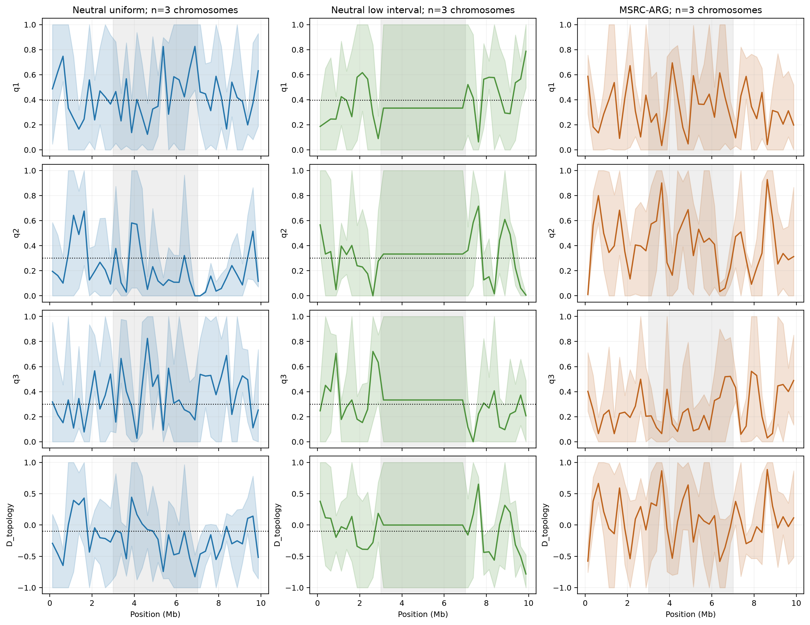
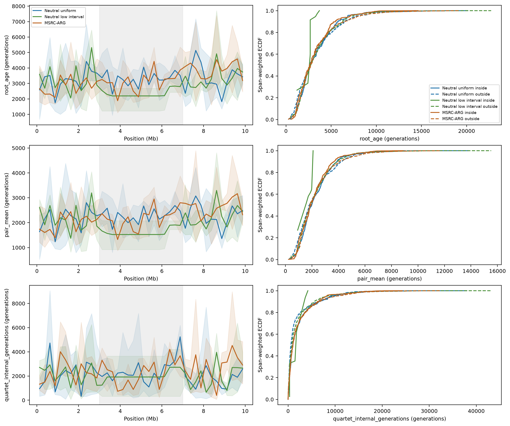
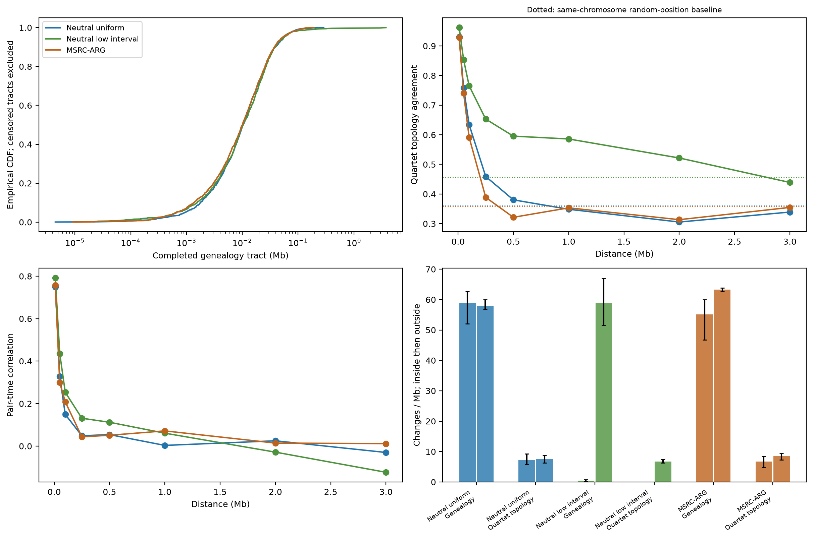
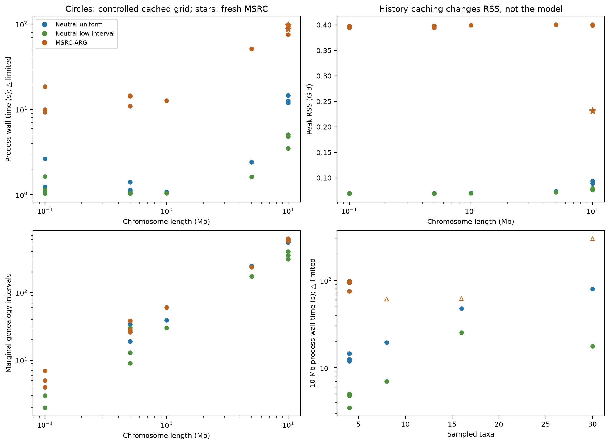

# MSRC-ARG at 10 Mb: measured scalability and scientific limits

## Assessment

**CONDITIONAL for four taxa; NOT READY for the requested approximately
30-taxon, replicated Positional ASTRAL datasets.** MSRC-ARG completed genuine
10-Mb chromosomes for all three prespecified four-taxon seeds. Full inline
history-to-export process times were **87.29–98.09 seconds**, with peak RSS
**236.70–237.91 MiB**. At 30 taxa, neutral controls completed, but the MSRC run
hit a 300-second limit while still at generation 54.34, before its first
species divergence at generation 100. No completion time is extrapolated.

Every completed chromosome passed interval/tree/species-time checks. This is
not yet strong marginal-distribution validation at the new parameters:
three chromosomes are underpowered, and the matched M=2000 exact Moran
calculation fails numerically in the existing theory implementation.
Population-genetic statistics are therefore deferred under the task's
scalability-first rule. No SMC′ kernel or existing SMC′ claim is changed.

## Biological setup and opportunity before execution

The baseline has diploid Ne=1000 in every extant and ancestral population
(M=2000 gene copies). For four taxa the species tree is
`((A:100,B:100)AB:100,(C:100,D:100)CD:100)ROOT;` with a 50-generation root
extension; background origin age is 250 generations. Balanced trees with
8, 16 and 30 tips use the same 100-generation divergence increments; the
30-tip origin is 550 generations. One haploid lineage is sampled per taxon.
Selection is zero. The native, shared, no-mutation Moran process starts with
1000 of 2000 root copies in one background, with binomial daughter sampling;
tip backgrounds are sampled from the realized history. This is standing
half-frequency ancestry at origin, not a single-copy founder model. Histories
are not conditioned on survival, terminal patterns or successful simulation.

The baseline rate is r=1e-8 per bp per generation (1 cM/Mb for the usual small
recombination-fraction interpretation). At 10 Mb the unsplit lineage has
rL=0.1 recombination opportunities per generation and 4 Ne rL=400. The neutral
low-rate map has r inside [3,7) Mb multiplied by kappa=0.01, giving integral
0.0604 per generation and population-scaled value 241.6. The initial n rL T0
opportunity is recorded in preflight data; it is not an upper bound on the
full recombining ARG. Carriers branch, overlap, coalesce and retire, so neither
event count nor runtime should be assumed linear in L.

Three comparisons share the same species demography:

1. Ordinary neutral ARG, uniform r.
2. Ordinary neutral ARG, kappa*r throughout the suppressed interval.
3. MSRC-ARG (`reservoir_v1` internally): uniform base map, with cross-background
   suppression inside the interval during the structured phase. Within-background
   marks still occur. Older than the origin, ancestry and recombination revert
   to the ordinary unstructured model.

The third model does not impose the second model's physical map on every
ancestral lineage. Its region can therefore have a much weaker visible effect.
Lowering neutral recombination changes dependence, not the neutral MSC target.

This is a favorable recent-population baseline, not a claim about ancient
species, Ne=100000, selection or old background origins. Higher M and longer
structured histories can be substantially more expensive and were not certified.

## Design, measurements and failures

[Configuration and runnable workflow](../validation/chromosome_scalability/README.md).
The primary grid uses L=100 kb, 500 kb, 1 Mb, 5 Mb and 10 Mb for four taxa;
8, 16 and 30 taxa are tested at 100 kb and 10 Mb. Seeds 101, 202 and 303 are
used at 100 kb, 500 kb and 10 Mb for the four-taxon comparisons. Sensitivity
attempts use r=0.5e-8 and 2e-8, and MSRC kappa=0, 0.1 and 1. All attempts,
including censored sensitivity runs, remain in the data.

Jobs are isolated sequential processes. Initial limits are 30 seconds for
short chromosomes, 60 seconds for long ones and 1.5 GiB RSS. Six explicitly
prespecified cases were replayed with 300 seconds: all three original four-taxon
10-Mb MSRC seeds and all three 30-taxon model conditions. Inline history replay
then measured the same three four-taxon MSRC chromosomes end to end. These
replays are not six additional independent chromosomes. No failed chromosome
was replaced or selected away. History and ARG RNG streams are independent
SeedSequence children `[seed,taxa,0]` and `[seed,taxa,1]`; paired settings reuse
the same history.

The archive has **67 dataset attempts: 50 complete, 15 time-limited and two
blocked by a history-cache failure**, plus six separately recorded history jobs.
[All measurements](../validation/chromosome_scalability/results/analysis/benchmark_metrics.csv)
include process and simulation times, peak RSS, event counts, intervals,
distinct dated genealogies, nodes/edges, file bytes, export cost, peak carriers
and segments, runtime per marginal interval, failed stage and partial generation.
Completed metrics are blank for failed runs, not reported as zero. Sampling
heartbeats trace carriers and segments through evolutionary time; snapshots
can occur mid-event and are not exact maxima or complete candidate tables.

### Four-taxon 10-Mb MSRC-ARG, complete inline workflow

| Seed | Process seconds | Peak MiB | Intervals | Distinct dated trees | Recombination / transfer / coalescence | Nodes / edges | Tree / event bytes | Newick export seconds |
|---|---:|---:|---:|---:|---|---|---|---:|
|101|98.09|236.77|571|543|4819 / 295 / 4817|426 / 1535|92324 / 1302420|0.0260|
|202|87.29|236.70|622|580|4960 / 279 / 4950|434 / 1723|99724 / 1336940|0.0237|
|303|96.28|237.91|612|577|5094 / 392 / 5091|451 / 1659|98692 / 1391464|0.0238|

Maximum simultaneous carriers are 76–82 and stored segments 465–506. Inline
history generation takes 1.98–2.31 seconds; ARG simulation takes 82.85–94.51
seconds. Process time includes interpreter startup, history, simulation,
validation and all exports. The same cached-history runs take 75.49–98.46
seconds and about 409–410 MiB; loading the large Python pickle retains more
memory. Inline and cached event logs, coordinate trees, Newick and marginal
summaries are byte-identical for every seed. Timing differences are workload
variability, not different chromosomes or independent replications.

The seed-101 cached length series has process times about 9.96, 10.93, 12.73
and 51.39 seconds at 100 kb, 500 kb, 1 Mb and 5 Mb; its initial 10-Mb run
hit 60 seconds. The subsequent same-seed run completed at 98.46 seconds.
Fixed history-processing cost dominates short MSRC chromosomes. Tree export
is small in this case; the expensive part is ancestral event scheduling.
The figure distinguishes the controlled cached length series from fresh
history-to-export measurements; no mixed-workflow speedup is inferred.

### Thirty taxa

| 10-Mb model, seed 101 | Process seconds | Peak MiB | Intervals / distinct dated trees | Outcome |
|---|---:|---:|---|---|
|Neutral uniform|80.16|120.52|2522 / 2508|complete|
|Neutral low interval|17.65|89.07|1379 / 1375|complete|
|MSRC-ARG, inline history|301.43|1171.84|unavailable|300-second simulation/pipeline limit|

Neutral uniform has 1556 nodes/9049 edges; neutral low has 907/5024. Their
Newick exports take 0.522 and 0.284 seconds, respectively. A cached species-MRCA
lookup accelerated the benchmark validator without reducing its checks; the
original low-control attempt had reached its limit in validation.

The 30-taxon shared history **generated successfully**: 2,432,209 records in
about 18 seconds. Serializing that Python object exceeded 1.5 GiB, blocking
the two initial MSRC jobs. The inline retry bypassed serialization and used
about 1.14 GiB, but still timed out in ARG simulation. At the stop it had
190 carriers, 192 stored segments and only advanced to generation 54.34;
partial events were 165 recombinations, 163 background transfers and five
coalescences. These are censored diagnostics, not finished event totals.
The remaining bottleneck is real frequency-boundary/event scheduling work,
not simply a benchmark-cache artifact. No estimate of the unobserved finish
or later peak memory is offered.

Environment: macOS 26.6.2 x86_64, Python 3.14.5; exact package versions are in
[environment.json](../validation/chromosome_scalability/results/environment.json).
Hardware model/core/RAM queries were unavailable in the sandbox. Timings are
local measurements, not portable performance guarantees.

## Audit and optimizations

The original scheduler rebuilds same-population pair options and recombination
hazards at every event and frequency boundary. With C carriers and F frequency
boundaries this includes work on the order of the sum over epochs of
`sum_population(C_population^2)`, plus carrier/map calculations. F grows with
M, population branch durations and count-history changes, independently of
chromosome length. Increasing L increases carrier proliferation, overlaps,
retained segments and logged events, compounding scheduling cost. Shared
history storage, C and stored segment count govern memory alongside event and
node/edge storage. Tree-sequence construction, simplification, file writing,
event export and Newick export are timed separately in each completed summary.

A preliminary 30-second neutral 10-Mb profile spent about 87% in repeated
completed-material retirement. It was censored and is not a completed speed
comparison. The following exact-preserving changes were implemented:

- Endpoint sweep with coverage count and XOR carrier identity finds material
  present on only one active carrier. Only affected carriers are rebuilt;
  prior half-open interval and 1e-12 per-carrier merge semantics are retained.
- Built-in fixed-history rates are memoized, bounded to 8192 recombination
  hazard entries; pair rates, frequencies and boundaries reset each epoch.
  Custom adapters/maps bypass caching. The legacy two-background marker-storage
  hazard keeps its original calculation.
- Same-population indices skip incompatible pairs while preserving the original
  eligible pair order. Original rate functions, arithmetic sum order, event
  choices, frequency boundaries and RNG draws are preserved.
- Tree-sequence output declares `generations` as its time unit.

No event generator, rate formula, biological assumption, marker geometry,
background-transfer rule, origin rule or redundant/null event was removed.
Skipping frequency boundaries or changing clocks remains a separate algorithmic
project with reproducibility and distribution tests, not an assumed safe edit.

Pinned unoptimized Git source `5138370` and optimized simulation produce
identical nodes, edges, events and peak counts in four paired regressions
(neutral, low-map, multitaxon and genuine M=2000 MSRC cases). The MSRC 100-kb
pair took 33.30 versus 7.38 seconds in that diagnostic. This single-input ratio
is not a universal speedup or an unobserved 10-Mb baseline measurement.
[Regression digests](../validation/chromosome_scalability/results/regression.json).

## Scientific validation and figures

All 50 completed attempts passed complete coverage, one root per interval,
expected labels, binary topology, nonnegative branches and species-MRCA lower
bounds for every ancestral node. MSRC event reconstruction additionally checks
shared-history background occupancy and same-background rate `1/(2 Ne p_h)`
younger than origin, with ordinary `1/(2 Ne)` coalescence older than origin.
Breakpoints are half-open and intervals tile [0,L). A separate post-run audit
parsed every exported Newick, checked labels, ancestral dates, chromosome IDs,
CSV/Newick equality and exact interval tiling for all 50 complete exports.
[Export audit](../validation/chromosome_scalability/results/export_audit.json).
Some early raw `.trees` files say `unknown` time units; times were always
generations, and archived example copies annotate that unit explicitly.

At selected positions only one tree per independent chromosome contributes a
quartet observation. q intervals use exact 95% Clopper–Pearson intervals;
D_topology uses a conservative Bonferroni difference of 97.5% binomial intervals.
The practical tolerance is ±0.05. **N=3 cannot establish marginal equivalence.**
Window plots use span-weighted statistics within 250-kb windows, followed by
means across chromosomes. Shaded bands are observed chromosome min–max ranges,
not confidence intervals; adjacent trees/windows are not independent replicates.

The existing exact finite-M theory from `msrc-paper` was attempted at these
matched parameters. `full_species_tree.py`'s binomial inheritance kernel raises
`OverflowError: int too large to convert to float` for M=2000 when multiplying
`comb(M,a)` by floating probabilities. The Moran target was not computed;
[traceback and source hashes](../validation/chromosome_scalability/results/theory_check.json)
are retained. No constant-p or diffusion approximation replaced it. The separate
exact neutral MSC limit is q=(0.39677505,0.30161247,0.30161247); it is drawn only
for neutral controls. Scientific agreement of the large-M MSRC marginals
remains unresolved, despite earlier small-domain validations.

q1=AB|CD, q2=AC|BD, q3=AD|BC; D_topology=q2−q1 is **not Patterson's D**.
Grey shading marks [3,7) Mb. The MSRC column has no substituted theory line.

Root ages, average pairwise MRCA times and the total internal edge length of
the unrooted quartet are in generations, not substitutions/site. Distribution
panels weight each genealogy by its genomic span. The narrow low-map inside
curve reflects long correlated tracts in only three chromosomes; it is not
evidence that suppressed recombination changes the neutral marginal law.

Completed genealogy tract ECDFs exclude left/right censored tracts. Quartet
agreement is compared with each chromosome's random-position composition
baseline; pair-MRCA correlation uses a 10-kb sampling grid. Both are averaged
across three chromosomes. At 100 kb, low-map topology agreement is about 0.76
versus roughly 0.6–0.64 in the uniform/MSRC cases; long-lag fluctuations are
finite-chromosome effects, not precision estimates. Change bars show inside
then outside rates and observed seed ranges, not confidence intervals.

Neutral low-map genealogy changes are 0.25–0.75/Mb inside versus 51.5–67/Mb
outside; quartet changes are zero inside in these three chromosomes. Uniform
controls have 52–62.75/Mb inside versus 56.83–60 outside. MSRC-ARG has
46.75–60/Mb inside versus 62.67–63.83 outside, with overlapping biological
sources of dependence and much weaker suppression than the low-map control.
In the MSRC seed-101/202 runs, 4745/4817 and 4898/4950 coalescences are older
than origin, respectively. Most recorded coalescences therefore see ordinary
ancestry, where the MSRC cross-background suppression no longer applies.
These are descriptive spatial patterns, not formal evidence for a changed
marginal distribution or a universal effect size.

Circles are cached-grid measurements; stars are inline full workflows. Open
triangles mark time limits rather than completion. No extrapolated points.
A marginal tree-sequence interval need not be a unique dated genealogy:
consecutive identical genealogies and later recurrence are distinguished by
pairwise-MRCA signatures. In the completed four-taxon MSRC chromosomes there
are hundreds, not thousands, of distinct dated trees.

## Positional ASTRAL and next work

Coordinate export already contains `chrom,left,right,midpoint,tree_id,newick`,
with continuous zero-based half-open bp intervals and a rooted tree with
branch lengths in generations. Samples retain taxon labels; reproducible
configurations accompany exports. Native `.nwk` has one line per interval.
The planned Positional ASTRAL consumer's input contract/importer was not
available in this repository or local ASTER documentation, so direct ingestion
was not demonstrated. An adapter may need chromosome/replicate IDs, window
centers, units and weighting conventions. Do not round continuous breakpoints
into gaps, or treat duplicated window-center trees as new independent trees.

Neutral 30-taxon examples provide thousands of correlated intervals. That does
not establish MSRC readiness: four-taxon success cannot certify the requested
30-taxon, multiple-chromosome study. The requested pipeline is **NOT READY**
under the measured five-minute/1.5-GiB budget. Four-taxon proof-of-scale is
**CONDITIONAL**, pending stronger matched marginal validation and an explicit
consumer format. Further ARG optimization is needed for the target workload.
An efficient, scientifically validated position-dependent SMC′ remains
important; the existing frozen-reference SMC′ whole-chromosome mismatch is
not solved by these engineering changes and is not a certified substitute.

Recommended next steps, in order:

1. Stabilize the original theory's binomial probabilities (e.g. log-domain or
   stable PMF evaluation), test normalization and agreement at small M, and
   resource-test large-M operators. Do this as a reviewed theory change, not
   a hidden approximation in the benchmark.
2. Profile 30-taxon scheduling on fixed shared histories; compact history
   storage and selective/incremental event updates need exact-rate and seeded
   regression tests. Do not change the biological parameters just to finish.
3. Increase independent chromosome replication after exact targets are
   available; test ±0.05 marginal criteria with adequate Monte Carlo precision.
4. Obtain the Positional ASTRAL input contract and validate an explicit adapter,
   then run replicated multitaxon benchmarks at empirical demographies.
5. Develop and validate a position-varying structured SMC′ joint law separately.
6. Add population-genetic statistics only after those scalability/validity gates.

## Deferred population-genetic work

No Phase 8 statistics module or mutation overlay was implemented. The present
one-haploid-per-taxon sampling cannot supply within-population diversity or
Tajima's D, and the balanced quartet has no designated outgroup for polarization.

| Statistic | Required next implementation |
|---|---|
|dXY|Genealogy expectation mu times pairwise path length (2 mu T for contemporaneous tips); population pair averaging and windows; sequence estimates after mutation overlay|
|pi|At least two haploid samples per population, population metadata, within-population pair averaging|
|FST|Explicit estimator and sampling design; validate against an independent implementation; do not silently equate estimators|
|Patterson's D|Designated ingroup ordering/outgroup, polarized biallelic mutation patterns, ABBA/BABA windows and chromosome/block uncertainty; distinct from q2−q1|
|Tajima's D|Within-population sample size, segregating sites and mutation model; sequence/window calculation|

Use a suitable existing mutation simulator (e.g. msprime on the tree sequence),
with separate mutation seeds and units, rather than building another mutation
engine. Genealogy expectations and finite-mutation observations must be reported
separately.

## Tests and scope

Full simulator suite: **343 passed**, one existing validation-grid warning,
185.60 seconds. Eight new tests cover randomized sweep/brute retirement,
interval tolerances, cached/direct rates, custom-adapter bypass, genomic
span-weighting, exact uncertainty intervals, tract censoring and species-time
rejection/export checks. Existing historical ARG/legacy regression fixtures
also pass. All four pinned-engine scientific digests and all three inline/cache
file regressions match. Full logs and results are archived in the benchmark
folder. No tests or failing attempts were removed to improve this assessment.

Core changes are limited to `msrcsim/arg/coalescence.py`, `engine.py`, the new
`rates.py`, and additive time-unit metadata in `output/tree_sequence.py`.
The benchmark worker/driver, analysis, audits, examples, tests and documentation
are isolated additions. Existing SMC′ and production simulation configurations
were not modified.
