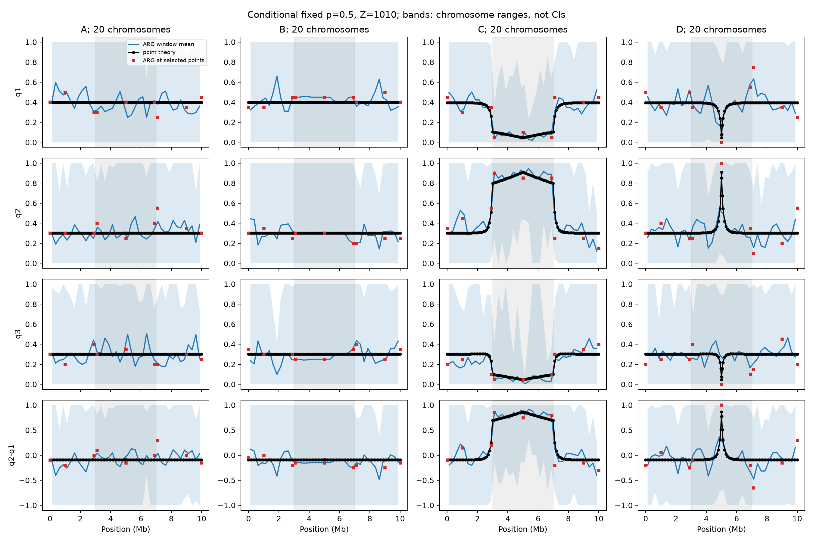
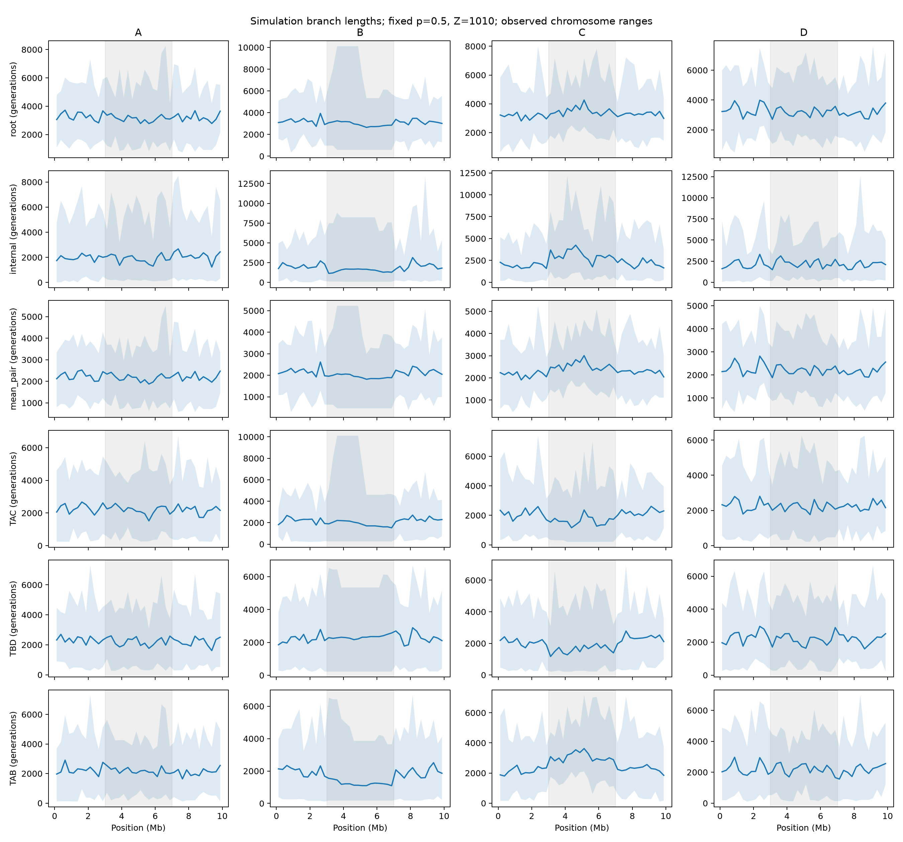
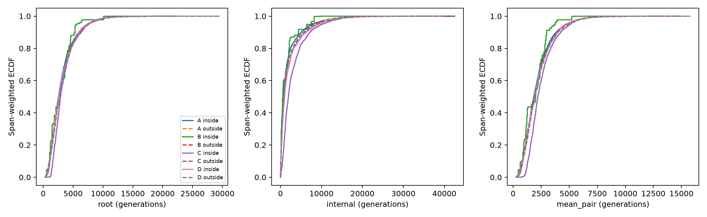
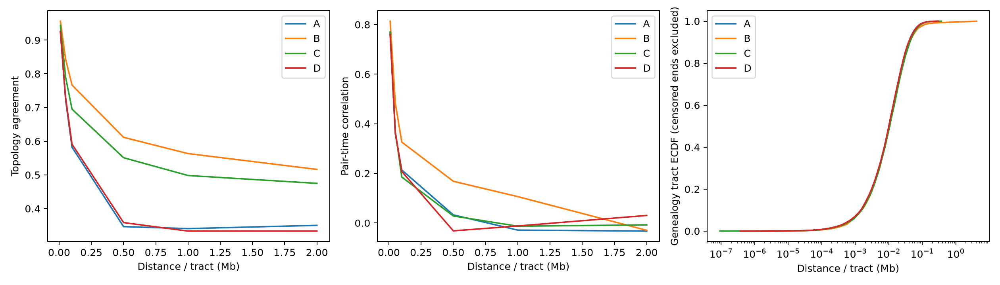
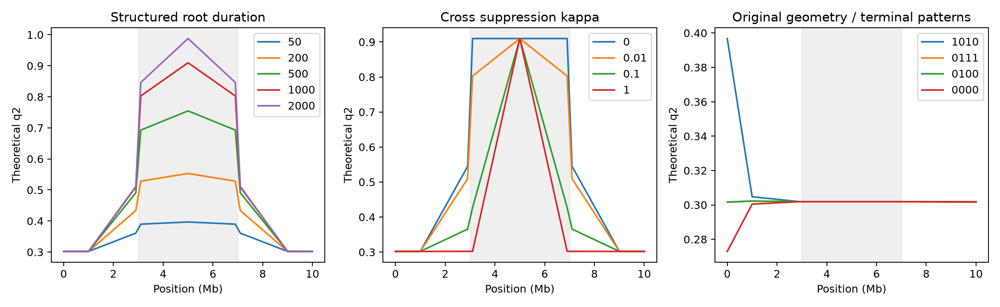
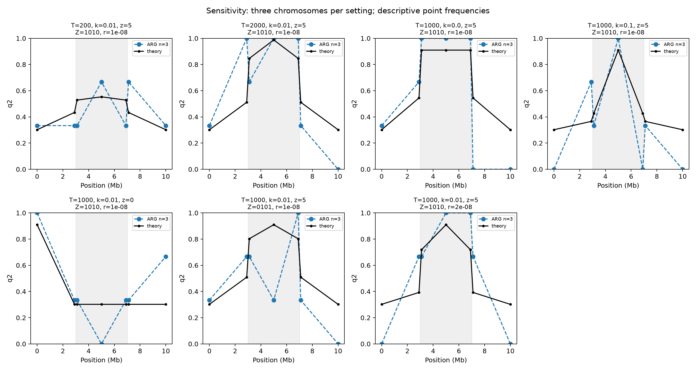

# Four-taxon MSRC-ARG positive control at 10 Mb

## Question and experimental scope

The earlier scalability setup was not a test of the strong conditional
four-taxon signal. Here the independent, existing full multispecies
prescribed-frequency theory is calculated before the ARG runs. The selected
positive control has fixed p=0.5, terminal ABCD=1010, Ne=1000, root age 200
generations, 1000 generations of structured root ancestry (origin age 1200),
marker 5 Mb, a region of suppressed recombination [3,7) Mb, r=1e-8 per bp per
generation and kappa=.01. The frequency history is externally prescribed on
all terminal, sister and root populations. This is a conditional positive
control, not a conditional sample from a stochastic Moran prior.

## Measured main result

All four main conditions completed 20 independent 10-Mb chromosomes each.
At the marker, observed q2 is .25 (A), .30 (B), .85 (C) and 1.00 (D), against
predictions .301612, .301612, .909776 and .909776. C's exact 95% interval is
[.6211,.9679]; D's is [.8316,1]. The broad localized alternative signal is
reproduced qualitatively and its marker magnitude is compatible with theory.
Precise marginal agreement over the whole chromosome remains unresolved.

Four of 108 individual point/q comparisons exclude their target from an
uncorrected 95% interval: A q2 at 7.1 Mb (.55 versus .3016), C q2 at 7.1 Mb
(.25 versus .5093), D q1 at 7.1 Mb (.75 versus .3958), and D q2 near 10 Mb
(.55 versus .3018). These discrepancies are retained. The comparisons are
correlated and not corrected for multiple testing; they are not proof of
systematic bias, but cannot be reported as passing tests. More independent
replication is needed, particularly near the region boundaries.

In C, inside-region chromosome-averaged TAC/TBD are approximately 1613/1617
generations, versus TAB/TAD 3079/3044. Outside they are 2164/2215 versus
2201/2347. C's mean internal branch length is 3107 generations inside versus
2022 outside, and root age 3512 versus 3209. These span-weighted contrasts
show the expected pairing and branch distortion in simulation; analytical
time-distribution agreement is not established. The neutral low-map control
also has variable regional branch summaries because there are only 20 linked
chromosomes; that variation is not a changed neutral marginal law.

## Independent predictions and explanation of the previous experiment

The theory grid covers root durations 50,200,500,1000,2000 generations, kappa
0,.01,.1,1, markers 0/5 Mb and terminal patterns 1010,0101,0111,0100,0000.
It calls the original balanced prescribed-frequency operator, including
terminal and sister populations, rather than an isolated ancestral population.
The effective switching intensity is the integral of physical r times cross
retention between the marker and the queried position. Generations and
per-generation rates are used consistently.

For Z=1010 and a centered marker, predicted q2 is:

| Structured root generations | Marker (5 Mb) | Just inside (3.1 Mb), k=.01 | Far outside (0 Mb), k=.01 |
|---|---:|---:|---:|
|50|.396775|.389825|.301871|
|200|.553120|.528227|.301873|
|500|.754747|.692849|.301873|
|1000|.909776|.802758|.301873|
|2000|.987790|.846367|.301873|

Thus marker placement and structured duration have different roles. Centering
the marker puts rho=0 at 5 Mb and small rho across the suppressed interval;
increasing duration makes same-background coalescence likely before origin.
With the old marker at 0 Mb, the unsuppressed [0,3) Mb path contributes at
least .03 per generation to rho for every position in [3,7) Mb, regardless
of kappa there. A small kappa cannot undo this contribution.

The original three realized terminal configurations were not 1010/0101.
Changing their labels would change the experiment's conditioning. The grid
quantifies those configurations separately, and shows the old geometry rapidly
loses a marker-associated alternative signal. Under an *independent fixed-half*
terminal prior, 1010/0101 together have mass 1/8 and three draws miss both with
probability (7/8)^3=.670. This is illustrative only: it is not the correlated
Moran prior's pattern probability. An exact decomposition of the original
stochastic histories' effects requires the still expensive finite-M calculation.
The earlier data therefore do not identify equal causal contributions from
sampling, duration and marker geometry. Plotting only three chromosomes also
provides very weak frequency precision.

## Matched chromosome experiments

A is a uniform neutral ARG; B a neutral ARG with a physically reduced map
inside [3,7); C the structured MSRC-ARG with cross suppression k=.01; D the
same structured history and terminal states with k=1. Model C retains the
within-background recombination in the original generator. Model D retains
conditioning at the marker even though its suppression is removed. Therefore
D can show a narrow marker peak; it should not be assumed to have the neutral
marginal at the marker.

The 100-kb and 1-Mb pilots retain r and demography and scale marker/region
coordinates with L. Their switching profile differs from 10 Mb; they test
execution cost and validity. All corrected pilots complete. Initial B inputs
used a list where the map interface requires a tuple; those two pre-simulation
input errors are retained, followed by explicit corrected same-seed attempts.
No failed biological trajectory is replaced. A profiled 1-Mb C pilot and event
counts are archived.

The main design prespecifies seeds 100–119 in each of A–D. Model conditions
share seed numbers; independent seed numbers, not neighboring windows, are the
replication units. Additional sensitivity cohorts use seeds 100–102 with one
change at a time: duration 200/2000, kappa 0/.1, marker 0, pattern 0101 or r=2e-8.
Each process is limited to 120 seconds and 1.5 GiB. Independent model cohorts
can run concurrently; runtime is diagnostic, not a controlled speed comparison.
No ARG event generator, SMC′ code or population-genetic statistics is changed.

Every completed native tree sequence is checked for full chromosome coverage,
labels, binary topology, nonnegative branch lengths and species-MRCA time
constraints. Results include tree sequences, genomic intervals and dated-tree
summaries per independent chromosome. Selected point estimates and exact
Clopper–Pearson q intervals are written separately from span-weighted 250-kb
window means. Observed chromosome ranges in window figures are not confidence
intervals. N=20 cannot certify a tight ±.05 equivalence criterion at all points;
N=3 sensitivity results are descriptive.

## Figures and interpretation

Theory curves are point predictions; ARG window curves are genomic averages.
Their difference near steep marker peaks is partly a change of estimand;
formal point comparisons use the point-estimate CSV. q1=AB|CD, q2=AC|BD,
q3=AD|BC, and D_topology=q2−q1. The theory predicts a broad alternative signal
for C and a much narrower marker signal for D. Reduced neutral recombination
alone increases persistence while preserving the neutral MSC topology target.
No window is counted as an independent chromosome.

Root ages, mean pairwise MRCA times and the unrooted quartet internal-edge
length are in generations. AC and BD share initial backgrounds; AB and AD
have opposite backgrounds. These branch-length results are simulation-based
predictions. The audited quartet operator provides topology probabilities,
not matched analytical predictions for these time summaries. A directional
simulation contrast must not be described as an analytically validated time
prediction or as mutation-rate variation.

Topology agreement and pair-time correlation use a 10-kb grid and chromosome
averages. Dated genealogy tracts merge consecutive identical full pair-MRCA
signatures; endpoint-censored tracts are excluded from their ECDF. Correlated
positions and recurrent tree topologies are not new independent observations.

The sensitivity cohorts show observations at selected coordinates, with only
three chromosomes per setting. Duration, suppression, geometry, label symmetry
and recombination intensity are specified in the panel labels and raw inputs.
The broad C signal follows rho_eff, not a blanket change in every genealogy
inside an arbitrarily named region.

## Stochastic Moran status and numerical correction

The original inheritance formula overflowed converting large integer binomial
coefficients before multiplication by small probabilities. It now evaluates
the same binomial probabilities with scipy.stats.binom.pmf. No normalization,
diffusion approximation or change to daughter inheritance is introduced.
Small-M direct-formula comparisons, large-M log-gamma comparisons, normalization
and absorbing endpoints pass. All 86 original/new theory tests pass, including
balanced and pectinate cases.

At M=2000 the inheritance preflight now succeeds. The original 50-generation
root case was attempted for 30 and 120 seconds; the centered-marker,
1000-generation root case was also attempted under an explicit budget. Full Moran recursion attempts
are retained with explicit time budgets; their stage, traceback and peak RSS
are recorded in `large_M*_attempt.json`. Operator evaluation cost remains a
separate issue from the fixed numerical overflow. No approximate Moran target
has replaced an unavailable finite-M result.

Stochastic conditional 1010 experiments are consequently not certified here.
They require the posterior history law given the terminal pattern. Fixing 1010
on unconditioned Moran histories would be incorrect. The fixed-path positive
control cannot supply that posterior or validate unconditional Moran behavior.
The next stage is a practical exact M=2000 target and independently generated
Moran chromosomes with correct terminal sampling/posterior conditioning.

## Empirical comparison and remaining questions

The Atlantic cod summaries were inspected in msrc-paper's
`empirical/atlantic_cod/results/atlantic_cod_main_table.tsv` and corresponding
results text. LG01 and LG02 have inside arrangement-minus-baseline contrasts
1.000 and .919604, versus outside -.232766 and .027273. These aggregate many
frozen informative quartets and population windows, rather than the single
simulated ABCD quartet. They provide a qualitative arrangement of the plots,
not an estimate of the simulation's Ne, origin duration, marker or kappa.
Cod LG07 is weak/null and LG12 has additional caveats; a universal empirical
signal is not assumed. The simulation's q2−q1 orientation corresponds to
arrangement-minus-baseline only after the quartet partitions are aligned.

The matched fixed-frequency experiment addresses whether the existing ARG can
show the established theoretical signal. It does not fit cod, Anopheles,
fire-ant or Neoaves biology and does not demonstrate a common causal mechanism
for those datasets. No gene-flow or selection explanation is inferred from a
qualitative resemblance.

Next steps are to improve finite-M operator performance, obtain adequately
precise independent replication for marginal equivalence, analytically validate
branch-time rewards where available, and then test true stochastic/posterior
Moran designs. Empirical fitting remains a separate scientific task.

## Verification and reproducibility

The simulator suite passes 343 tests with one existing validation-grid warning
in 187.72 seconds. The theory suite passes 86 tests. All completed chromosomes
pass tree/species-time validity checks. Four pointwise frequency discrepancies
remain as documented above; these are statistical validation limitations, not
a passing numerical equivalence claim.

Run commands, configurations, seeds, native tree sequences, interval summaries,
profiles, figures, numerical-attempt tracebacks and test logs are under
[validation/chromosome_biological_validation](../validation/chromosome_biological_validation/README.md).
The stable binomial theory fix is committed in msrc-study as 87362a2. Existing
unrelated working files there were preserved.

All 21 sensitivity chromosomes completed, including doubled recombination
(r=2e-8) at approximately 81–107 seconds. The 90 main/pilot attempts include
88 completed chromosomes and the two retained pre-simulation input errors;
all 80 main 10-Mb chromosomes completed. The profiled pilot is an additional
replay, not another independent replicate. Some independent processes ran
concurrently, so these times should not be interpreted as controlled speed
comparisons.

No specific ARG event-generator defect was identified in this exercise. The
strong positive control demonstrates that the previous weak profile need not
reflect an inability to generate the theoretical pattern. Marker geometry,
structured duration and terminal conditioning explain the qualitative contrast;
finite-chromosome noise and the retained pointwise discrepancies prevent a
blanket claim that every marginal is validated. The next experiment should
increase replication under these same inputs, rather than changing the biology
to eliminate a discrepancy.
