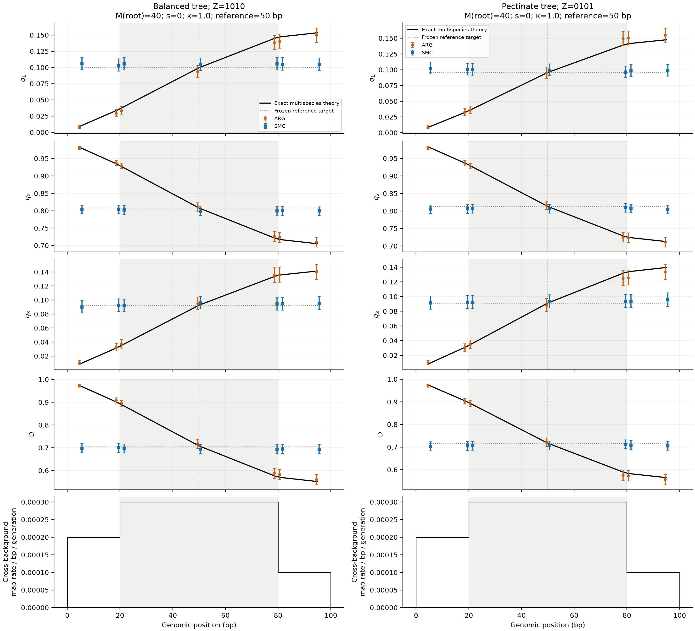
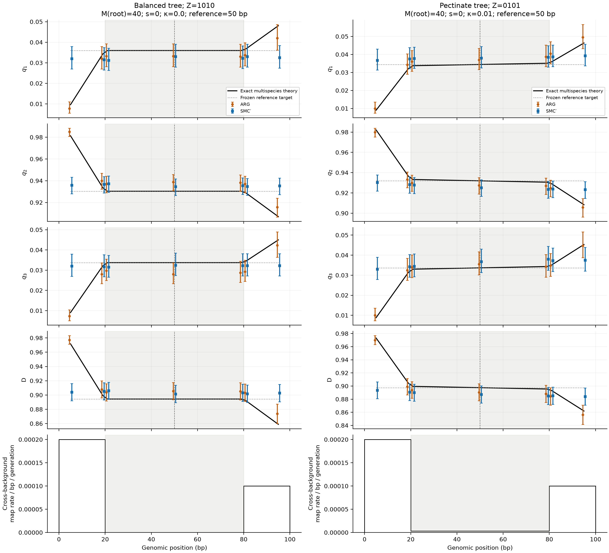
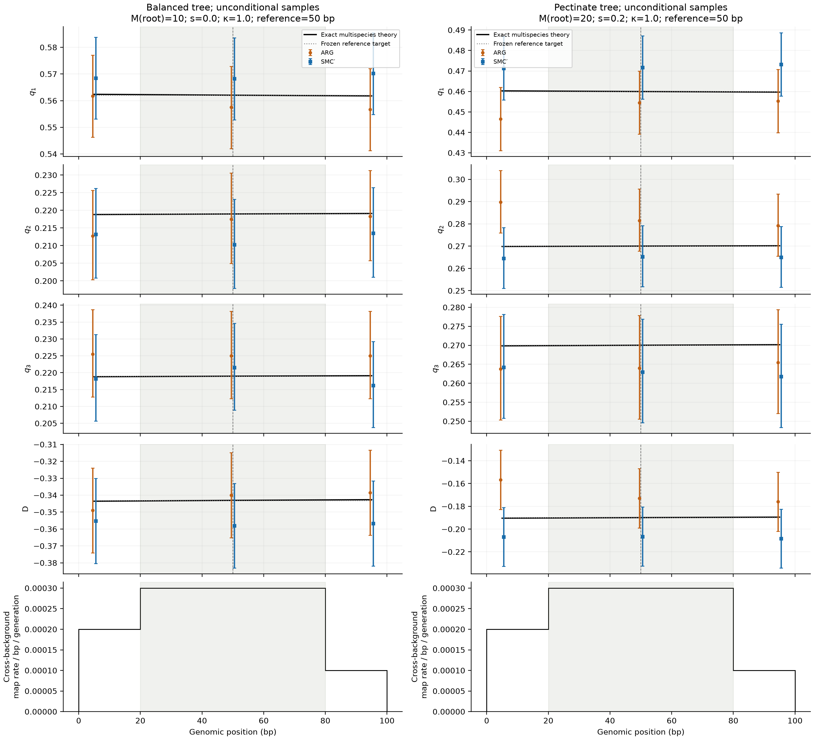

# Exact multispecies Moran theory versus ARG and SMC′

## Assessment

**CONDITIONAL PASS** for the matched marginal target on the tested domain;
**FAIL** for interpreting the current frozen-reference SMC′ as an exact
position-dependent whole-chromosome model. Individual unresolved equivalence
criteria remain failures to establish agreement, not demonstrated model errors.

This is an independent comparison with the existing finite-M hierarchical
MSRC theorem, not a new quartet derivation. Production theory, Moran,
single-locus, ARG and structured SMC′ source files are unchanged.
The [compatibility audit](MSRC_MORAN_SPATIAL_COMPATIBILITY.md) explains the
13 parameter conventions and the boundary-support argument. The reusable
[workflow](../validation/moran_spatial/README.md) imports theory from an
external checkout and records source hashes, configuration and seeds.

## Theory reused and model matching

The theory source is `msrc-paper` (the local checkout of `msrc-study`), commit
`ba260f8d4303b5d3bc884fb76a9c5a5032b7e477`; the simulator production base is
`956e20add44859903b99f00ac1d3b648aca67da5`. The imported modules are
`moran_quartet_operator`, `full_species_tree`, `unbalanced_species_tree`,
`prescribed_frequency_quartet` and `matrix_free_quartet`.

The unconditional comparisons call the full balanced joint recursion or the
pectinate joint/conditional recursion, with the original
`A_n=Q_M kron I_d + blockdiag(G_n(k).T)` and dimensions 2,6,11,19.
The pectinate calculation includes the three-lineage intermediate interval
and topology mass absorbed before lineage D enters. That mass is retained;
it is not replaced by a four-lineage ancestral kernel. Positive terminal,
sister, intermediate and root durations, unequal branch populations, an
asymmetric balanced tree, and mixed root count laws are exercised.

Fixed-frequency and fixed realized-path comparisons call the original
prescribed-history operators, including all species branches and their
chronological frequency epochs. A realized path is not substituted into an
unconditional Moran expectation. The existing fixed-half full-tree function
is only an independent numerical regression, never the main theoretical target.

For each evaluated position, theory uses

```
rho_eff(x) = integral_between(marker,x) r0(y) k_cross(y) dy.
```

The integral splits at both physical-map and suppression boundaries. ARG
uses the reservoir_v1 model. SMC′ is compared both with this position-specific
theory and with its declared target at rho_eff(50). The latter distinction is
necessary even at the first genomic position: SMC′ initializes from the
reference target, rather than the marker-distance target at the scan start.

### Fixation/loss: why the policies differ but these comparisons are admissible

The original theorem's finite-copy floor and the spatial models' strict errors
are globally different. Nevertheless, under the audited no-mutation Moran
process, K=0 and K=M are absorbing. A background missing in a parental
population cannot appear through binomial daughter sampling. Terminal samples
and physical parental marks therefore cannot create that background in the
corresponding younger subtree, and backward switching into it has rate zero.
On every occupied positive finite-M state the count is at least one, so the
floor is inactive and strict and legacy coalescence rates coincide.

This reachable-state argument allows the original unconditional theorem to be
compared without modifying its floor or conditioning on survival. It assumes
honest absorbing Moran paths, unbiased binomial inheritance, supported terminal
sampling, one root origin, ordinary MSC older than the origin, and the ARG's
effective parental-reservoir interpretation. It does not validate arbitrary
frequency paths, mutation/resurrection, incompatible supplied tip states,
sub-one-copy frequencies, alternative founder rules or microscopic phase
inheritance. Those require a separate boundary/model specification.

## Design and prespecified criteria

There are 13 primary settings with 4,000 independent chromosomes per method
per setting: six fixed-frequency settings, two fixed realized Moran paths,
and five unconditional Moran settings. Root M ranges over 8,10,12,20,40;
branch counts include 10,12,20,30,40,60. Native selection includes
-0.2,0,+0.1,+0.2. Root durations are 3,4,5,30,80 generations; terminal and
sister durations vary, including asymmetric sister lengths 3 and 2.
Configurations specify all sizes, durations, root laws and branch maps.

Chromosomes share their realized history and sampled tip states across methods
within a replicate, but each replicate is independent. Different positions
are never pooled as independent replicates. Both uniform-model and suppressed
region cases use the same piecewise physical map; kappa=1,0,0.01 distinguish
cross retention. Positions 5,19,21,50,79,81,95 span the marker distances and
both boundaries; shorter stochastic-history grids use 5,50,95.

Before simulation the practical tolerance was set to ±0.05 for each q and D.
PASS requires the entire pointwise 95% difference interval inside this band.
Quartet intervals are Wilson; D uses the multinomial variance, including the
negative dependence of q1 and q2. An interval entirely outside the practical
band is a demonstrated mismatch; an overlapping interval that does not fit
is unresolved uncertainty. These are pointwise criteria, not simultaneous
whole-grid confidence bands. No nonsignificance test substitutes for equivalence.

No frequency-survival or computational-success filter is used. A failed method
invalidates its whole-chromosome empirical comparison; failures are recorded
and never replaced. Zero-probability terminal patterns have undefined
conditional distributions and are explicitly labeled, rather than counted as
uncertain empirical comparisons.

## Primary results

| Setting | ARG: position target | SMC′: reference only | SMC′: position target | SMC′: frozen target |
|---|---:|---:|---:|---:|
| balanced_M40_cond1010 | 28/28 | 4/4 | 7/28; 17 mismatch; 4 unresolved | 28/28 |
| pectinate_M40_cond0101 | 28/28 | 4/4 | 6/28; 17 mismatch; 5 unresolved | 28/28 |
| balanced_M20_unconditional | 28/28 | 4/4 | 28/28 | 28/28 |
| pectinate_M20_unconditional | 28/28 | 4/4 | 28/28 | 28/28 |
| balanced_plateau_cond1010 | 28/28 | 4/4 | 25/28; 1 mismatch; 2 unresolved | 28/28 |
| pectinate_plateau_cond0101 | 28/28 | 4/4 | 26/28; 1 mismatch; 1 unresolved | 28/28 |
| balanced_realized_M40 | 10/12; 2 unresolved | 3/4; 1 unresolved | 8/12; 4 unresolved | 11/12; 1 unresolved |
| pectinate_realized_M40 | 12/12 | 4/4 | 10/12; 2 unresolved | 12/12 |
| balanced_stochastic_M10 | 12/12 | 4/4 | 12/12 | 12/12 |
| pectinate_stochastic_M20 | 11/12; 1 unresolved | 4/4 | 12/12 | 12/12 |
| balanced_stochastic_M8 | 12/12 | 4/4 | 12/12 | 12/12 |
| balanced_asymmetric_M12 | 12/12 | 4/4 | 12/12 | 12/12 |
| balanced_absorbing_endpoints_M10 | 12/12 | 4/4 | 12/12 | 12/12 |

Across the 252 primary position/metric checks, ARG passes 249, with three
unresolved and no demonstrated beyond-tolerance mismatch. SMC′ passes 251/252
against its frozen target, including 51/52 at the reference coordinate; the
remaining reference D interval is unresolved. Against the position-specific
target, SMC′ passes 198, has 36 demonstrated mismatches and 18 unresolved
criteria. These correlated check counts are descriptive, not independent
replicates or a global significance calculation.

Two ARG D intervals on the fixed balanced realized Moran path exclude zero
but do not establish practical equivalence: at 5 bp the error is -0.0340,
CI [-0.0595,-0.0085]; at 95 bp it is -0.0361, CI [-0.0620,-0.0101]. They
are unresolved small discrepancies, not proof of exact identity or confirmed
implementation errors. More independent draws are required to distinguish
Monte Carlo variation from a small systematic bias. The third ARG unresolved
interval is in the unconditional pectinate Moran setting. The independent
single-locus control passes 251/252 primary criteria, with one unresolved.


The table counts only the actual sampling distribution (`pattern=all`), not
duplicate rows for a fixed explicit terminal pattern. The complete tables
also contain the two named discordant patterns and all 16 joint-pattern laws.
In explicit-pattern experiments only conditional frequencies are empirically
estimated; unconditional joint/pattern estimates are left blank, avoiding the
incorrect interpretation of fixed-pattern counts as prior samples.

The absorbing-endpoint initial law `pi_old=(delta_0+delta_M)/2` provides an
explicit boundary control. The full theorem gives
(0.5531200,0.2234400,0.2234400) at every position; all 12 ARG, all 12 SMC′
and all 12 single-locus criteria pass. Conditional laws for impossible
1010/0101 patterns in this setting are undefined, not empirical failures.

### Frozen-reference failure away from the reference

On the balanced M=40, Z=1010 broad-map case, at 5 bp the SMC′ D error is
-0.2737, 95% CI [-0.2939,-0.2536]; at 95 bp it is +0.1431,
CI [0.1229,0.1632]. At its 50-bp reference the error is -0.0142,
CI [-0.0343,0.0060], satisfying the practical criterion. The analogous
pectinate errors are -0.2691 at 5 bp and +0.1412 at 95 bp.
These departures track the frozen-reference approximation; the separately
recorded frozen-target comparisons distinguish them from a failure of the
reference transition kernel.



The black curve is the original full multispecies prediction at each sampled
position; the dotted line is the reference target; symbols have pointwise 95%
Monte Carlo intervals. The lower panels show the physical map times cross
retention. Shading marks the declared region of suppressed recombination;
the broad-map panels use kappa=1. Parameters and unequal branch sizes are
specified in `cases.json`; editable SVG versions accompany the PNGs.

### Nearly constant marker-path integral

Inside [20,80], complete cross suppression gives constant rho_eff despite
ongoing within-background recombination. At kappa=0.01 the integral varies
only slightly. These are more favorable windows, as assessed separately
from positions outside them. Suppression does not establish correctness
throughout the chromosome: even the balanced kappa=0 case has an SMC′ D
error -0.0677 at 5 bp, CI [-0.0798,-0.0557], outside the favorable interval.



## Conditional and unconditional Moran results

The genuine unconditional Moran settings pass 59/60 primary ARG criteria
(one unresolved) and all 20 SMC′ reference criteria. This supports the
identified reachable-state comparison on this finite grid, without claiming
uniform accuracy for arbitrary demographic histories. Replaying the exact
prior seeds confirms within-branch count changes in all 4,000 histories of
each non-endpoint Moran setting. For example, the balanced M=10 sample contains
2,020 histories with loss somewhere in the tree and 1,583 with fixation;
the pectinate M=20 sample contains 985 and 1,858 respectively. These counts
can overlap across populations. `history_audit.json` records all five settings;
this is not a survival-conditioned experiment.



The main unconditional runs integrate the genuine stochastic Moran history
and terminal sampling law. Their joint table uses observed pattern frequencies,
not equally weighted conditional quartets. Rare discordant patterns in only
4,000 prior draws have limited precision, so a separate explicit conditioning
experiment was specified with 160,000 prior-history/terminal draws per shape.
Only Z=1010 or 0101 is selected, before any genealogy is simulated. The fixed
attempt budget never replaces failed trajectories. This samples the correct
posterior history given Z, unlike fixing tip states on prior histories.

| Stochastic setting | Prior draws | Z=1010 selected | Z=0101 selected | ARG practical checks | SMC′ reference checks |
|---|---:|---:|---:|---:|---:|
| Balanced M=10 | 160,000 | 1,975 | 1,944 | 8/8 PASS | 8/8 PASS |
| Pectinate root M=20, selection +0.2 | 160,000 | 3,227 | 3,218 | 8/8 PASS | 8/8 PASS |

Each set of eight checks is q1/q2/q3/D for both patterns. The exact pattern
probabilities are 0.0122386 each in the balanced case, and 0.0198644/0.0195758
in the pectinate case. The predicted conditional q vectors are strongly
asymmetric; the comparisons recover the distortion, not just an unconditional
average. No selected spatial simulation failed. The independent single-locus
control passes 15/16 criteria; balanced Z=1010 D remains unresolved (error
-0.0238, with its interval just beyond the practical band). It is not relabeled
as equivalent. Details are in the conditional-Moran result directories.

### Explicit check of topology accumulation below the root

An additional 4,000-chromosome fixed-history pectinate experiment evaluates
whether the first coalescence occurs before the species-tree root. The
original recursion predicts early q1/q2/q3 mass
(0.1821771,0.0199388,0.0199388). ARG estimates
(0.17575,0.02075,0.02075); SMC′ at its reference gives
(0.18350,0.02000,0.02250). All nine early-mass comparisons, including the
independent single-locus control, meet the ±0.05 interval criterion. These
supplemental early-event intervals use normal binomial standard errors.
This directly checks the nonzero three-lineage/pre-root contribution, rather
than validating only the final shared-population kernel.

## Numerical and software checks

The original full balanced and pectinate recursions agree with independently
evaluated dense exponentials at M=4 to 2.8e-17 and 1.4e-16 in joint probability.
Sparse and matrix-free shared-population calculations agree at M=8,20,80 to
less than 2e-17, with normalization errors at most 4.5e-16. Semigroup and
all four generator checks give errors at most 1.4e-15. Full fixed-half
species-tree regressions also agree. These checks separate numerical theory
error from percent-scale Monte Carlo or spatial approximation errors.

Numerical runtime, Python-traced allocation and process peak RSS are recorded
in `numerics.json`. The largest numerical check has dimension 1,539; these
small checks do not establish large-M scaling, and process peak RSS is a
cumulative process measurement rather than a per-matrix allocation estimate.

The final full simulator suite passed **335 tests, one existing validation-grid
warning, in 200.75 s**. All **34 selected original theory tests** passed,
and all **19 adapter/validation tests** passed with the external source set.
The earlier full run also passed 334 tests before the last aggregation test
was added. Test logs are archived in the results directory.

Original theory tests cover the same operators imported by this workflow.
New tests check map integration, sizes/origin mapping, all joint/conditional
normalizations, pre-root three-lineage mass, exact Moran clock/selection
matching, frozen-history queries, tree classification, failure handling, and
proper empirical interpretation of explicit terminal conditioning. No
production source, existing assertion or scientific tolerance was weakened.

## Failure attribution and limits

- No numerical operator error is supported by the cross-checks. This is not
  a new proof of the existing theorem.
- No new marginal simulator bug is demonstrated at a matched target in this
  grid. Failed practical intervals due to finite Monte Carlo precision remain
  unresolved and are listed, not silently removed.
- Boundary policies differ globally; their agreement here depends on the
  reachable-support argument, not on resampling trajectories until admissible.
- Reservoir parental exchangeability is still a model assumption. Quartet
  marginals do not validate finite-population marker phase or the spatial joint law.
- Broad position-specific SMC′ failures are attributable to the frozen rho
  target. Its conditional parental-path closure and spatial correlations are
  separate approximations, not validated by these marginal comparisons.
- The adapter currently requires contemporary A/B/C/D samples, named canonical
  clades, positive even M and a root-older-boundary origin. Other origin placements
  and demographic mechanisms need explicit adapters/validation.

Next steps are to refine unresolved Monte Carlo intervals, extend the explicit
support/boundary specification to additional demographic histories, and test
larger exact-operator systems with resource accounting. A position-varying
SMC′ transport kernel would be a separate theoretical/software task; none was
introduced here.

## Reproduction and artifacts

See [workflow commands and schemas](../validation/moran_spatial/README.md),
`cases.json`, `additional_cases.json`, `provenance.json`, per-case theory and
comparison tables, all-pattern joint tables, conditional-Moran summaries,
numerical checks and test logs under
[the results directory](../validation/moran_spatial/results).
Raw chromosome draws are regenerated by the same fixed seeds; compact
scientific tables and vector figures are committed. The actual source hashes
are archived so a later external-theory update cannot silently change the
provenance of these results.
