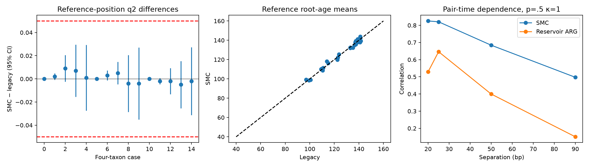
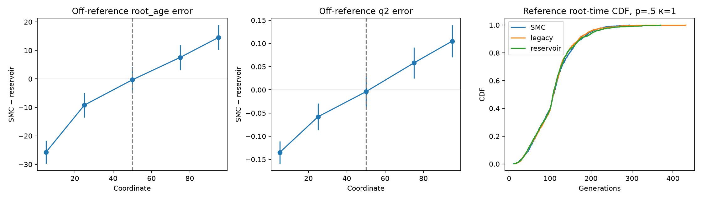
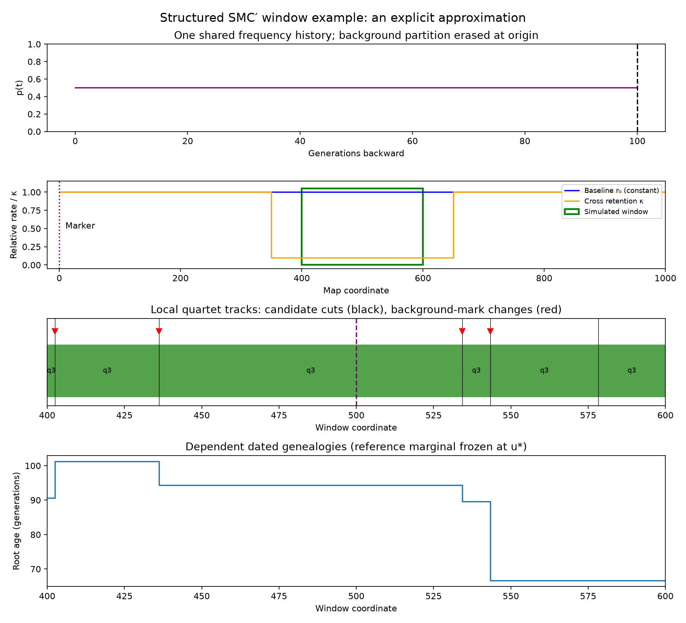

# Structured SMC′ prototype: validation and scientific status

## Decision

**CONDITIONAL PASS as a declared reference-window simulator; FAIL as a
whole-chromosome replacement with position-specific MSRC marginals.**
The new implementation is genuinely sequential: it retains one dated local
tree and background paths, cuts and re-coalesces a subtree, and never runs an
ARG. Its frozen-reference marginal passes the recorded checks. Measurable
spatial and off-reference marginal errors prevent a general MSRC-SMC′ PASS.
No speed advantage over the ARG references is established.

The construction and its two approximations (inherited state at the cut and
frozen marker-path switching scalar) are specified in
[the model document](msrc_smc_structured_model.md). Existing neutral SMC′,
legacy single-locus MSRC, original ARG and reservoir ARG code is unchanged.

## Primary marginal experiment

For 2 and 4 taxa, p=0.2,0.5,0.8 and k=0,0.01,0.1,0.5,1, simulate 1,000
independent chromosomes **per method per setting** (30 settings). Use Ne=20,
origin 100 generations, marker 0, chromosome [0,100), r0=0.0002, the whole
chromosome as the suppressed region, and reference position 50. The four-tip
species tree is `((A:2,B:2)AB:2,(C:2,D:2)CD:2)ROOT;`; the two-tip species tree
has zero divergence time. Terminal states alternate 0/1 in alphabetical order.

Compare the structured SMC′ genealogy at coordinate 50 with independent
legacy MSRC and reservoir ARG draws using rho=r0*k*50, the same history,
terminal states, Ne, and origin. The legacy and new strict convention agree
on occupied frequencies here because the finite-copy floor is inactive.

The predeclared marginal tolerances in the validator are absolute error 0.05
for q1/q2/q3 and D, and relative error 10% for root/pair/internal time means.
Report chromosome-level standard errors and marginal 95% difference intervals.
Holm correction uses all 315 tests in the primary family. Do not equate
absence of a significant test with practical equivalence.

| Comparison | Tests | Holm significant (0.05) | Difference CIs wholly within practical tolerance |
|---|---:|---:|---:|
| Structured SMC′ vs legacy | 150 | 0 | 147 |
| Reservoir ARG vs legacy | 150 | 0 | 144 |
| Structured SMC′ vs analytic two-lineage root mean | 15 | 0 | 15 |

The maximum structured-SMC quartet point difference is 0.011 and maximum
relative root-mean point difference is about 3.8%. The three unresolved
structured-SMC intervals were D at k=1 for all three p values. Each case was
expanded to 3,000 chromosomes using the same seed-stream design, including
the initial 1,000. All 21 structured-SMC comparisons in those expanded cases
then fit the original tolerances. This is refinement, not independent
replication. No criterion was relaxed.

The reference genealogies show the expected MSRC marginal distortion. At
p=0.5, q2 is 1.000 in both legacy and SMC′ at k=0, and 0.854 versus 0.850 at
k=1. In contrast, the ordinary MSC for this symmetric species tree has
q1=1-(2/3)exp(-4/40)=0.3968 and q2=q3=(1/3)exp(-4/40)=0.3016. The latter is
an analytic neutral control, not an additional Monte Carlo result.

### Analytic two-lineage reference

Before coalescence, transient background states are 00,01,11. At a fixed
coordinate with scalar rho:

```
Q = [-(2*rho*p+c0),       2*rho*p,                   0;
         rho*(1-p),          -rho,               rho*p;
                 0, 2*rho*(1-p), -(2*rho*(1-p)+c1)],
c0=1/[2Ne(1-p)], c1=1/[2Ne*p].
```

Starting in 01, S(t)=e01 exp(Qt) 1 up to T0; thereafter
S(t)=S(T0)exp[-(t-T0)/(2Ne)]. The independent target root mean is
`integral_0^T0 S(t)dt+S(T0)*2Ne`. At rho=0 this reduces to T0+2Ne=140.
Matrix exponentiation and quadrature provide all 15 independent analytic
checks, separate from either simulator.

## Background histories and time-varying trajectories

A separate audit compares total pre-root, pre-origin switching counts and
total dwell in backgrounds 0 and 1 at coordinate 50. It uses the primary SMC
histories and independent 1,000-replicate legacy and reservoir samples in all
15 four-taxon settings. There are 90 between-method comparisons: none remains
Holm significant. With a 10% mean-error criterion, only 34/45 SMC and 35/45
reservoir intervals fit wholly inside tolerance; the remaining background
comparisons are unresolved in precision, particularly rare switches. They
are not declared equivalent from hypothesis tests alone.

An additional rate audit compares each chromosome's switch count N to its
predictable integrated exposure
`rho*[p*dwell0+(1-p)*dwell1]`. Standard errors use independent chromosome
residuals. None of 45 method/setting tests is Holm significant. Total dwell
is a per-genealogy quantity, not a sample of uncensored independent holding
times: individual ancestral episodes are censored by coalescence/origin.
The raw audit generator preserves that distinction.

Two actual realized histories generated once each with seed 93 were shared
across 500 SMC and 500 legacy draws per history. The Moran path has 154
records and the Wright–Fisher path 29; both have explicit origin age 8,
Ne=20 and initial count 20. All 14 time/quartet/D comparisons have nominal
p>0.05 (maximum |z| about 1.863). This is a limited conditional-trajectory
check, not validation over the distribution of all Moran/WF paths. The exact
shared histories are committed for replay. The history records were checked
not to mutate during simulation.

## Spatial approximation error

For the primary chromosomes, estimate exact dated-genealogy agreement,
unrooted quartet topology agreement, rooted RF distance, root/pair-time
correlation at separations 20,25,50,90 bp. The ARG equality diagnostic uses
stored MRCA signatures at 15 significant digits; SMC equality uses stored
full-precision dated-tree MRCA times. Near-zero numerical distinctions below
that ARG precision are not resolved. RF clades are reconstructed from the
dated ancestry; trivial root/tip clades are excluded.

Bootstrap confidence intervals resample complete independent chromosomes
(250 resamples per comparison). They are descriptive intervals, not a
simultaneous family of spatial-equivalence tests. At p=0.5,k=1:

| Separation | SMC pair-time correlation | Reservoir pair-time correlation | SMC topology agreement | Reservoir topology agreement |
|---:|---:|---:|---:|---:|
| 20 | 0.825 | 0.529 | 0.974 | 0.923 |
| 25 | 0.820 | 0.646 | 0.978 | 0.933 |
| 50 | 0.684 | 0.400 | 0.957 | 0.861 |
| 90 | 0.497 | 0.151 | 0.918 | 0.759 |

This is substantial excess persistence, not spatial equivalence. Also report
agreement above its independent marginal baseline `sum_i q_i(x)q_i(y)` in
`topology_excess_agreement.csv`, because highly dominant quartets can make raw
agreement misleading. Completed and right-censored recombination-proposal,
genealogy-change and topology-change waits are tabulated separately. Tract
summaries distinguish interior from chromosome-boundary-censored tracts;
completed-only means are descriptive and are not unbiased lifetime estimates.
SMC candidate counts must not be interpreted as an ARG physical-event census.

### Suppression-boundary experiment

A second experiment uses map length 1,000, marker 0, r0=1e-5 outside
[300,700), r0=0.0002 inside, simulated window [250,750), reference 500,
p=0.5, and all five k values, with 500 independent chromosome pairs each.
Coordinates 275,325,500,675,725 cross both suppression boundaries.
For k=0 the interior target switching scalar is exactly constant
(rho=0.003) despite continuing within-background recombination. This is a
particularly appropriate domain for the frozen-reference approximation.

At 350-bp separation inside the region, SMC-minus-ARG correlation differences
were -0.054 for k=0 and -0.011 for k=0.01; their bootstrap intervals include
zero and are wide. At k=0.1 and 0.5, the differences were +0.187 and +0.169.
These are errors of the stated approximation, not grounds to retune the map
after seeing the result. More replication and narrower windows are needed
to establish any useful quantitative spatial tolerance.

### Failure of whole-chromosome marker-distance marginals

The frozen target intentionally has no coordinate-dependent change in rho.
The reservoir reference does. In the primary four-taxon p=0.5,k=1 case:

| Coordinate | SMC q2 | Reservoir q2 | Difference and 95% CI |
|---:|---:|---:|---:|
| 5 | 0.842 | 0.977 | -0.135 [-0.159,-0.111] |
| 95 | 0.856 | 0.751 | +0.105 [0.070,0.140] |

Root-age mean errors at those coordinates are -25.7 and +14.6 generations.
This fails the stated whole-chromosome scientific objective. The cause is
known: rho is held at its coordinate-50 value and the local inheritance
closure differs from the reservoir. A local generator invariant at each
coordinate would not itself solve marginal transport along a varying target.
No independent genealogy resets were added to conceal this discrepancy.





## Tests, optimizations and performance

The final focused regression run passed **56 tests in 44.92 seconds**:

```bash
MPLCONFIGDIR=/private/tmp/mpl .venv/bin/python -m pytest -o addopts='' -q \
  -p no:cacheprovider tests/test_msrc_smc_structured.py tests/test_msrc_smc.py \
  tests/test_msrc_smc_marginals.py tests/test_spatial_reservoir.py tests/test_msrc_arg.py
```

Tests cover exact neutral delegation with identical seeds, zero maps,
nonnegative dated trees, tip consistency, reproducibility, complete cross
suppression with within-background recombination, path-density balance,
original-edge expiration, origin erasure and numerical nextafter behavior,
invalid absent backgrounds, actual Moran/WF sharing, map plateaus, frequency
changes, and an independent Poisson switching-count target. The full existing
repository suite was not rerun; validated production code was not changed.

The audited 30-setting grid has maximum |log acceptance ratio| 1.07e-14;
expanded cases reach 1.64e-14. This agrees with the analytic cancellation in
the model. Default fast mode therefore omits repeated target/reverse-density
calculations; `audit_density: true` restores them. Both modes still consume
the same acceptance uniform, and a direct test verifies identical local trees
and histories under fixed seeds.

Profiling preceded optimization. Cached clade-to-population ancestry and the
current target density preserve the full local-tree/background output hash
for a 20-seed audit (`bff3933f...c4266060`). The original 32-taxon/1,000-bp
audited runtime was 84.2 s, cached audit runtime 2.13 s, and analytic fast
runtime 1.19 s. These are diagnostic one-seed measurements with allocation
tracing, not robust speedup estimates under controlled machine load.

Final fast-mode measurements (100/1,000 bp, r0=1e-5, k=0.1, p=0.5):

| Taxa | Structured SMC′ seconds (100 / 1,000 bp) | Original ARG seconds (1,000 bp) | Reservoir ARG seconds (1,000 bp) |
|---:|---:|---:|---:|
| 4 | 0.008 / 0.005 | 0.004 | 0.004 |
| 8 | 0.037 / 0.029 | 0.007 | 0.008 |
| 16 | 0.082 / 0.277 | 0.023 | 0.029 |
| 32 | 0.601 / 1.189 | 0.112 | 0.097 |

The final benchmark includes neutral SMC′, mark counts, time per mark,
adjacent distinct genealogies and traced Python memory. Neutral simulations
have different marginal laws and event counts; ARG marks and SMC proposals
also have different meanings. A one-seed count mismatch is not a matched-work
speed comparison. Maximum structured traced allocation is recorded per row
and excludes total process/native allocation. Additional eight-taxon runs
vary history boundaries, but their stochastic event counts also differ;
they do not establish a clean complexity exponent. No faster-than-ARG claim
is supported. Initial density evaluation, cut-epoch integration and copies
remain major costs in the final profile.

## Reproduction and artifacts

Run the example from the repository root:

```bash
MPLCONFIGDIR=/private/tmp/mpl .venv/bin/python -m msrcsim.smc.structured \
  --config examples/msrc_smc_structured.yaml --output /private/tmp/structured-smc-example
```

The map has length 1,000 but the explicitly simulated window is [400,600),
reference 500. Its saved realization has six local intervals and five
candidate proposals. The example folder contains dated Newick trees,
intervals, background histories, proposal/change records, sample backgrounds,
shared frequency history, quartet tracks and reproducibility metadata.



Reproduce the audited primary grid with separate p blocks:

```bash
MPLCONFIGDIR=/private/tmp/mpl .venv/bin/python validation/msrc_smc_structured/grid.py \
  --output /private/tmp/structured-primary --p 0.5 --replicates 1000
# Repeat for p=0.2 and 0.8, then:
MPLCONFIGDIR=/private/tmp/mpl .venv/bin/python validation/msrc_smc_structured/summarize.py \
  --input /private/tmp/structured-primary --output /private/tmp/structured-summary
MPLCONFIGDIR=/private/tmp/mpl .venv/bin/python validation/msrc_smc_structured/backgrounds.py \
  --input /private/tmp/structured-primary --output /private/tmp/structured-backgrounds --replicates 1000
MPLCONFIGDIR=/private/tmp/mpl .venv/bin/python validation/msrc_smc_structured/diagnostics.py \
  --input /private/tmp/structured-primary --backgrounds /private/tmp/structured-backgrounds \
  --output /private/tmp/structured-summary
```

`histories.py`, `spatial_window.py`, `benchmark.py`, and `plot_example.py`
provide independent commands for their corresponding experiments. The
validation program accepts `--taxa`, `--p`, `--kappa` and `--replicates` for
expanded cases. Seeds, parameters, versions and field meanings are recorded
in source, JSON and the compact results README. Large raw per-chromosome
primary files are reproducible under `/private/tmp` and are not committed.

The first realized-history attempt stopped with an absent-background error
at a numerical origin boundary. Aligning origin erasure with the legacy
1e-10 tolerance resolved the run; a dedicated nextafter test guards it.
Genuine absent-state histories still raise, and no history/genealogy is
silently retried. Scientific discrepancies and unresolved intervals remain
in the tables. No failing scientific criterion was weakened or removed.

## Next work

1. For practical use, restrict to windows with a nearly constant marker-path
   integral, or regions whose complete cross suppression makes it constant.
   Quantify the tolerated variation in rho and spatial error before production.
2. Derive a position-varying target transport/conditional-parent closure;
   merely substituting local rho into an invariant kernel is insufficient.
3. Validate more admitted frequency histories and specify founder/bridge rules
   for genuine fixation/loss jumps; do not silently change the legacy floor.
4. Expand independent low-k spatial checks and profile cut-basis/history
   integration. Future speed claims require replicated long-chromosome
   benchmarks against matched reference laws and clearly defined mark counts.
