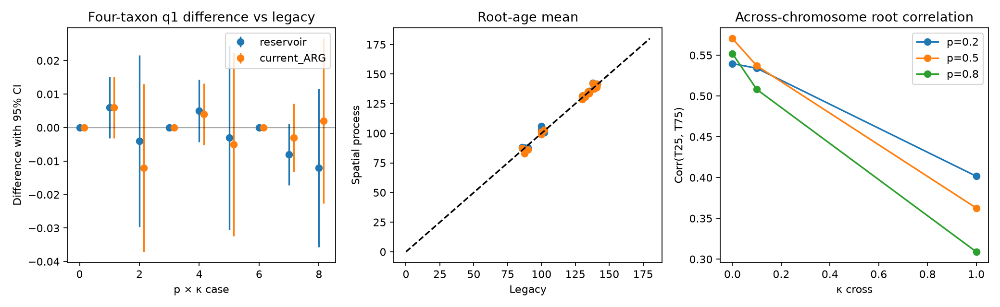
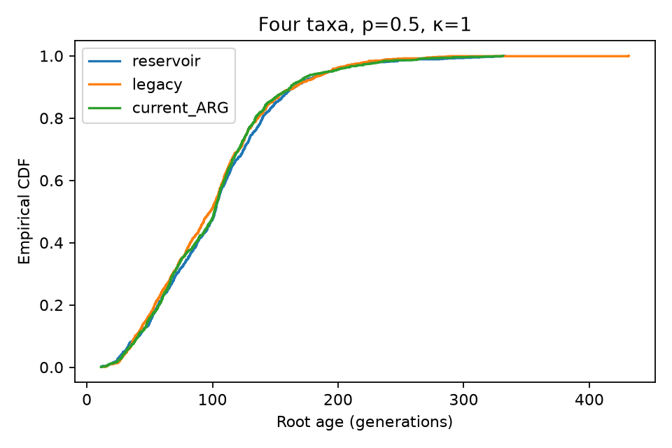

# Reservoir-ARG prototype validation report

## Assessment

**CONDITIONAL PASS for a reference prototype under fixed interior frequency
histories.** A reproducible spatial process is implemented and supports the
legacy marginal generator on the stated admissible domain. This is not a
validated genome-scale MSRC simulator, a new SMC′, or a demonstration of
finite-population marker-phase accuracy.

The primary predeclared practical tolerances were 0.05 absolute quartet
frequency error and 10% relative root/pair mean error, with chromosome-level
uncertainty. Lack of Holm significance was not used alone as equivalence.
The design and future validation gates are in
[the implementation plan](msrc_spatial_implementation_plan.md).

## Experiments and results

All chromosomes use Ne=20, explicit origin 100 generations, L=100 bp,
marker z=0, suppressed region [0,100), r0=0.0002 per bp per generation,
and focal position 75. There are two taxa in a common ancestral population,
or four taxa on `((A:2,B:2)AB:2,(C:2,D:2)CD:2)ROOT;`, with terminal states
alternating 0/1 in alphabetical order. Fixed p values are 0.2,0.5,0.8 and
cross-retention values are 0,0.1,1. These small genomes test the coupled
generator, not biologically calibrated chromosome lengths.

The seeded primary run contains 18 settings × 1,000 independent chromosomes
for each of three methods: reservoir ARG, legacy single-locus MSRC with
rho=r0*k*75, and the current MSRC-ARG. All methods share the history and
terminal configuration; RNG streams are distinct. The two-tip CTMC supplies
an additional reference independent of the simulation scheduler.

| Comparison | Number of tests | Holm significant at 0.05 | 95% difference intervals wholly inside practical tolerance |
|---|---:|---:|---:|
| Reservoir vs legacy | 63 | 0 | 61 |
| Current ARG vs legacy | 63 | 0 | 60 |
| Reservoir vs two-tip analytic root mean | 9 | 0 | 9 |

The Holm family includes all 135 reported tests, including correlations among
quartet probabilities and duplicated two-tip root/pair metrics. This is
conservative, and no claim of universal equivalence is inferred from it.
The largest reservoir quartet point difference was 0.012; its largest
relative root mean point difference was about 5.9%.

Two practical intervals remained too wide in the initial reservoir run:
four taxa, p=0.2, k=1, for root and mean-pair times. That setting was expanded
to 10,000 replicates with the same seed-sequence design, including the first
1,000 draws. This is a refinement, not an independent replication. All five
reservoir comparisons then fit within their predeclared practical tolerances:

| Metric | Reservoir mean | Legacy mean | Difference | 95% difference CI |
|---|---:|---:|---:|---:|
| Root age | 102.2818 | 101.1485 | 1.1332 | [-0.2739, 2.5404] |
| Mean pair time | 71.3431 | 70.4689 | 0.8742 | [-0.0428, 1.7912] |
| q1 | 0.0932 | 0.0921 | 0.0011 | [-0.00694, 0.00914] |
| q2 | 0.8277 | 0.8294 | -0.0017 | [-0.01215, 0.00875] |
| q3 | 0.0791 | 0.0785 | 0.0006 | [-0.00687, 0.00807] |

The current ARG also has zero Holm-significant results in this small grid,
including the refined case. This does not validate its general marginal law:
the missing-marker constructed state has a generator discrepancy by a factor
of 17 (5 versus 85 map-distance units) at focal 85, marker 0, and material
[80,90). The generator audit is the evidence for that discrepancy; these
chromosome experiments did not establish its population-wide effect size.

## Direct event-measure checks

`rate_audit.py` draws 12,000 joint breakpoint/parent marks per combination of
p in {0.2,0.5,0.8}, h in {0,1}, and k in {0,0.1,1}: 216,000 proposals.
Focal-switch probability times total proposal hazard estimates the rate.
Observed rates agree with `p_cross * r0 * k * 85`; the largest absolute
standardized difference is 2.381. All zero-cross-retention switch counts are
zero. This checks the mark sampler, not complete genealogy distributions.
The row-level estimates, target rates, standard errors and difference
intervals are in `rate_audit.csv`.

## Spatial diagnostic

The same independent chromosomes supply root times at positions 25 and 75.
For four taxa and p=0.5:

| k | Root-age correlation | Chromosome-bootstrap 95% interval | Topology agreement |
|---|---:|---:|---:|
| 0 | 0.570 | [0.494, 0.646] | 1.000 |
| 0.1 | 0.537 | [0.463, 0.609] | 0.985 |
| 1 | 0.363 | [0.289, 0.430] | 0.835 |

Bootstrap sampling units are complete chromosomes (500 resamples); topology
intervals use Wilson bounds over 1,000 independent chromosomes. This is a
one-separation dependence diagnostic, not a calibrated tract-length law or
a multi-distance benchmark against the structured ARG. Suppression changes
both cross exchange and marginal structure in this model. Topology agreement
can be high merely because one topology dominates, so correlation and the
quartet comparisons are reported together.





## Regression tests and implementation checks

The focused run passed **39 tests in 41.10 s**, covering the new reservoir
adapter, existing MSRC-ARG, corrected neutral SMC′, and its marginal regression
checks:

```bash
MPLCONFIGDIR=/private/tmp/mpl .venv/bin/python -m pytest -o addopts='' -q \
  -p no:cacheprovider tests/test_spatial_reservoir.py tests/test_msrc_arg.py \
  tests/test_msrc_smc.py tests/test_msrc_smc_marginals.py
```

New tests cover the marker-absent event domain, exact coalescence and origin
rates, joint-mark switch probabilities, zero recombination, seed
reproducibility, complete cross suppression with nonzero same-background
recombination, valid output trees, and the neutral two-tip survival law. A
frequency jump stranding a carrier in an absent background raises an error;
nonfinite rate maps and missing origin are rejected. No failed scientific
test was removed or its acceptance threshold widened. The full repository
suite was not rerun; production simulator code was not edited.

The first validation attempt failed while parsing the legacy eight-decimal
Newick output under the strict ultrametric parser. The corrected validator
uses full-precision legacy coalescence records. A later summary-writing error
from a NumPy scalar was fixed and summaries regenerated from saved tables;
it did not change simulated draws or statistical criteria.

## Small performance audit

Two seeds per setting, 4/8/16/32 taxa, 100/1000 bp, r0=1e-5, p=0.5, k=0.1,
with Python allocation tracing enabled. The neutral SMC′ has no background
structure and therefore generates a different event distribution; these are
execution-cost diagnostics, not matched scientific workloads.

| Taxa | Reservoir median seconds | Current ARG median seconds | Neutral SMC′ median seconds |
|---:|---:|---:|---:|
| 4 | 0.0044 | 0.0045 | 0.0032 |
| 8 | 0.0084 | 0.0079 | 0.0170 |
| 16 | 0.0222 | 0.0235 | 0.0254 |
| 32 | 0.1012 | 0.1058 | 2.4023 |

Maximum traced Python allocation at 32 taxa was approximately 71 KB for the
reservoir adapter. This excludes total process/native-library memory and is
not a genome-scale bound. Detailed per-chromosome rows include sequence
length, seeds, elapsed time, and event counts. A cProfile run puts active
material retirement, rate evaluation, and interval handling among the main
costs. No general speed advantage is claimed.

## Artifacts, reproduction and limits

Compact results are under `validation/spatial_reservoir/results/`:
`marginals.csv`, primary/refined JSON summaries, refined marginal table,
`rate_audit.csv`, `spatial_summary.csv`, benchmark/profile, the CDF sample
records, and figures. Raw 18,000-chromosome spatial records are regenerated
by the validator; they are not all committed. Package versions are recorded
in the JSON summaries. All primary run scripts use seed 20261121 or the
explicit audit/benchmark seeds in source.

To refine or reproduce the reported extra setting:

```bash
MPLCONFIGDIR=/private/tmp/mpl .venv/bin/python validation/spatial_reservoir/validate.py \
  --output /private/tmp/reservoir-refined --replicates 10000 --case 4,0.2,1
```

The analytical generator claim is conditional on admissible histories and
matching the legacy coalescence convention. Remaining work includes internal
branch/D and background-dwell distributions; time-varying Moran/WF cases;
fixation/founder bridges; multi-distance and map-boundary spatial comparisons;
independent MSMS/pedigree checks; and larger-chromosome performance. These
limits prevent a production-readiness PASS, while the present results support
using this prototype as a clearly defined reference for the next research
stage.
